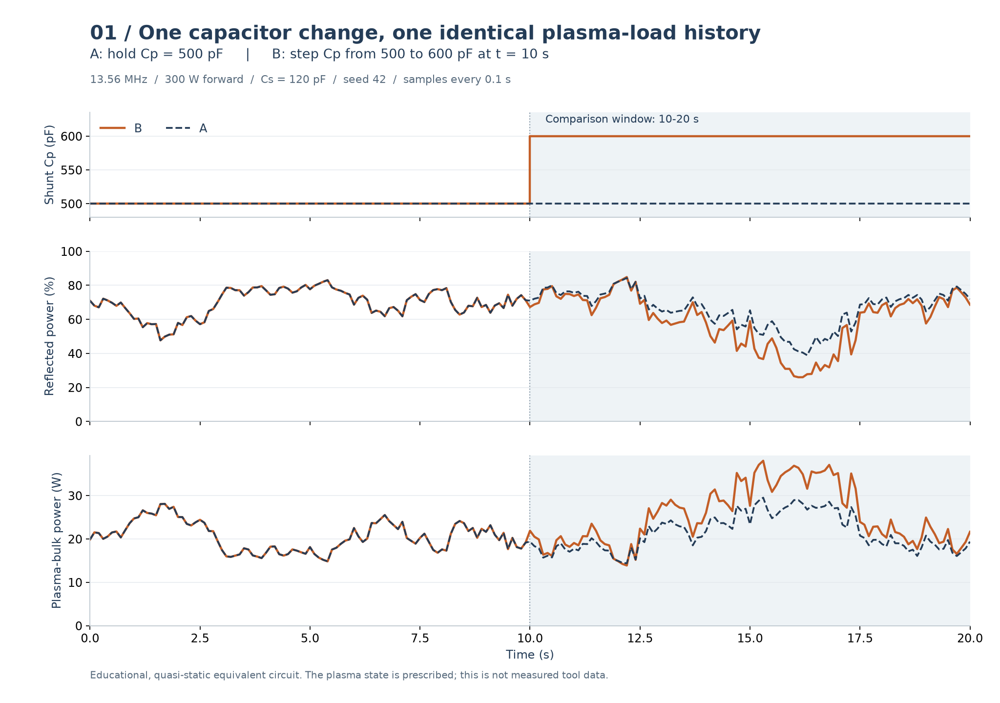
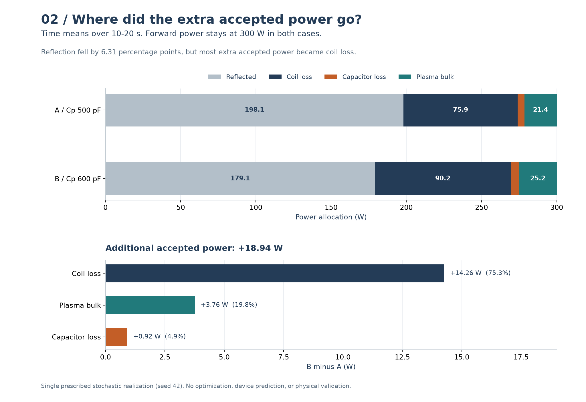

# 실험 01 — RF 매칭 커패시터 하나를 바꾸면 전력은 어디로 갈까?

**2026-11-16 · 개인 학습용 수치 실험 · RF 등가회로 / 합성 플라즈마 부하**

병렬 커패시터 Cₚ를 500 → 600 pF로 바꾸자, 같은 부하 이력에서 평균 반사 전력 비율이 **66.03 → 59.72%**로 줄었습니다. 플라즈마 벌크 흡수 전력은 **21.40 → 25.16 W**로 늘었지만, 추가로 회로에 들어온 전력의 약 **75.3%는 코일 손실**이 되었습니다. 반사율과 부품 손실을 함께 봐야 한다는 것을 확인하는 실험입니다.

실제 설비·웨이퍼 측정이 아닙니다. AI 에이전트가 기존 Python 모델을 실행하고 결과를 정리한 학습 기록이며, 사용자가 직접 수행한 현장 실험으로 표현하지 않습니다.

## 1. 무엇을 바꿨나?

질문은 “변동하는 부하가 같을 때, Cₚ만 바꾸면 반사 전력과 플라즈마 흡수 전력이 어떻게 달라질까?”입니다. 실행 전에 [plan.json](plan.json)에 비교 조건을 기록했고, 결과를 보고 값을 재탐색하지 않았습니다. 자동 정합·최적화 함수는 사용하지 않았습니다.

| 조건 | A: 기준 | B: 변경 |
|---|---|---|
| 0 ≤ t < 10 s의 병렬 Cₚ | 500 pF | 500 pF |
| 10 ≤ t ≤ 20 s의 병렬 Cₚ | 500 pF 유지 | **600 pF** |
| 직렬 Cₛ | 120 pF | 동일 |
| 순방향 전력 / RF 주파수 | 300 W / 13.56 MHz | 동일 |
| 매칭 코일 L / Q | 2 µH / 100 | 동일 |
| 커패시터 Q | 1000 | 동일 |
| 급전선 | 무손실 50 Ω, 길이 0.5 m, 속도 계수 0.7 | 동일 |
| 부하 변화 | seed 42, σ = 0.18, τ = 1.4 s | **완전히 같은 난수 이력** |
| 전자밀도 기준값 / 초기 쉬스 두께 합 | 2 × 10¹⁶ m⁻³ / 1 mm | 동일 |
| 유효 충돌 빈도 / 벌크 길이 / 전극 면적 | 2 × 10⁸ s⁻¹ / 30 mm / 200 cm² | 동일 |
| 시간축 | 0–20 s, 0.1 s 간격, 201개 표본 | 동일 |

Cₚ는 매칭 회로 입력에서 접지로 연결된 **병렬 커패시터**, Cₛ는 코일 뒤의 **직렬 커패시터**입니다. pF는 정전용량 단위입니다. Cₚ를 바꾸면 발생기에서 바라보는 입력 임피던스가 바뀝니다. 이번 비교에서는 전원 출력과 부하 이력을 고정해 이 효과만 분리했습니다.

## 2. 실제 계산 결과

아래 값은 **변경 이후 10–20 s 구간을 사다리꼴 적분한 시간 평균**입니다. 101개 표본을 사용했으며, 여러 시드의 통계 평균이 아닙니다.

| 관찰량 | A: Cₚ 500 pF | B: Cₚ 600 pF | B − A |
|---|---:|---:|---:|
| 반사 전력 / 순방향 전력 | 66.03% | 59.72% | **−6.31%p** |
| 반사 전력 | 198.09 W | 179.15 W | −18.94 W |
| 회로로 들어온 순전력 | 101.91 W | 120.85 W | +18.94 W |
| 플라즈마 벌크 흡수 전력 | 21.40 W | 25.16 W | **+3.76 W** |
| 코일 손실 | 75.94 W | 90.21 W | **+14.26 W** |
| 두 매칭 커패시터의 손실 합 | 4.57 W | 5.49 W | +0.92 W |
| 벌크 흡수 / 순방향 전력 | 7.13% | 8.39% | +1.25%p |

표는 각 값을 독립적으로 반올림했습니다. 원래 정밀도의 값은 [summary.json](data/summary.json)에 있습니다.



파란 점선은 A, 주황 실선은 B입니다. 10초 전에는 입력이 같아서 선이 정확히 겹칩니다. 이후 차이는 Cₚ 변경에서 생깁니다. 다만 B가 모든 시점에서 반드시 더 좋은 것은 아닙니다. 부하가 계속 변하므로 순간적인 효과도 변합니다.



**쉽게 읽으면:** 발전기에서 보낸 300 W 중 되돌아오는 전력이 약 19 W 줄었습니다. 그 19 W가 전부 플라즈마로 전달된 것은 아닙니다. 약 14.26 W는 코일에서, 약 0.92 W는 커패시터에서 추가로 소모되고, 벌크 흡수 증가는 약 3.76 W였습니다. 벌크 흡수는 기준 대비 약 17.6% 증가했지만, 입력 300 W 대비 비율은 여전히 약 8.4%입니다.

따라서 이번 결과는 “이 조건에서 평균 반사가 감소했다”는 관찰입니다. 약 60%의 전력이 여전히 반사되므로 좋은 최종 매칭이나 최적 레시피라고 판단하지 않았습니다. 막 두께·식각량·균일도는 이 실험에서 계산하지 않았습니다.

## 3. 어떤 모델과 수식인가?

회로는 `50 Ω 급전선 → 병렬 Cₚ → 직렬 L, Cₛ → 플라즈마 Rᵦ, Lᵦ, Cₛₕ`입니다. 내부 단위는 SI이며 전압·전류는 RMS, 페이저 부호는 exp(+jωt)입니다. 공간 격자는 없는 집중소자 모델입니다. 각 0.1초 표본에서 RF 정상상태 회로를 다시 풉니다. 13.56 MHz의 전자기 파형을 0.1초 간격으로 적분한 것이 아닙니다.

$$\Gamma(t)=\frac{Z_{\mathrm{in}}(t)-Z_0}{Z_{\mathrm{in}}(t)+Z_0},\qquad
P_{\mathrm{ref}}(t)=P_{\mathrm{fwd}}|\Gamma(t)|^2$$

- Γ: 발생기 기준면의 복소 전압 반사계수, 무차원. Γ 자체를 반사 전력 비율로 사용하지 않습니다.
- Zᵢₙ: 발생기 기준면의 복소 입력 임피던스, Ω. Z₀: 기준 임피던스 50 Ω.
- Pᵣₑ𝒻: 반사 전력, W. P𝒻𝓌𝒹: 순방향 전력 300 W. t: 시간, s.

$$P_{\mathrm{bulk}}=|I_b|^2R_b,\qquad
R_b=\nu L_b,\qquad L_b=\frac{m_e\ell}{n_e e^2 A},\qquad
C_{\mathrm{sh}}=\frac{\epsilon_0 A}{s_1+s_2}$$

- Pᵦᵤₗₖ: 모델의 벌크 저항에 흡수된 전력, W. Iᵦ: 벌크 경로의 RMS 복소 전류, A.
- Rᵦ: 벌크 유효 저항, Ω. Lᵦ: 전자 관성을 나타내는 등가 인덕턴스, H. ν: 유효 운동량 충돌 빈도, s⁻¹.
- mₑ: 전자 질량, kg. ℓ: 벌크 유효 길이, m. nₑ: 처방한 전자밀도, m⁻³. e: 기본 전하량, C. A: 전극 유효 면적, m².
- Cₛₕ: 두 쉬스의 직렬 등가 정전용량, F. ε₀: 진공 유전율, F/m. s₁+s₂: 두 쉬스 두께의 합, m. 이 실험에서 쉬스는 선형·무손실 커패시터입니다.

$$R_L=\frac{\omega L}{Q_L},\qquad R_C=\frac{1}{\omega C Q_C},\qquad \omega=2\pi f$$

- Rᴸ: 코일 직렬 손실 저항, Ω. L: 매칭 코일 인덕턴스, H. Qᴸ: 코일 품질계수, 무차원.
- Rᶜ: 커패시터 ESR, Ω. C: Cₚ 또는 Cₛ, F. Qᶜ: 커패시터 품질계수, 무차원.
- ω: 각주파수, rad/s. f: 주파수, Hz. Q는 일정하다고 가정했습니다.

부하의 느린 변동은 두 독립적인 합성 OU 상태 x, y로 만듭니다. 실제 압력·플라즈마 센서 데이터에 맞춘 값이 아닙니다.

$$x_{k+1}=a x_k+\sqrt{1-a^2}\,\xi_k,\qquad a=e^{-\Delta t/\tau}$$
$$n_{e,k}=n_0e^{\sigma x_k},\qquad s_{\mathrm{total},k}=s_0e^{\sigma(-0.35x_k+0.15y_k)}$$

- k: 표본 번호. x, y: 무차원 OU 상태, 각각 같은 형태의 식으로 갱신하며 초기값은 0.
- ξ: 매 표본의 독립 표준정규 난수, 무차원. y에도 별도의 독립 난수를 사용합니다. RNG는 NumPy default_rng의 PCG64, seed 42입니다.
- a: 표본 간 감쇠 계수, 무차원. Δt: 0.1 s. τ: 상관 시간 1.4 s.
- σ: 로그 변동 크기 0.18, 무차원. n₀: 밀도 기준값 2 × 10¹⁶ m⁻³로, 로그정규 과정의 정확한 시간 평균이라는 뜻은 아닙니다.
- s₀: 초기 쉬스 두께 합 1 mm. sₜₒₜₐₗ: 변동하는 두께 합. −0.35와 0.15는 학습용 합성 시나리오 계수이며 물성 상수가 아닙니다.

**이 버전에서는 흡수 전력이 증가해도 전자밀도·온도를 다시 풀지 않습니다.** A와 B의 밀도와 쉬스는 의도적으로 같습니다. 따라서 “Cₚ 변경으로 전자밀도가 증가했다” 또는 “증착/식각 성능이 좋아졌다”는 결론은 낼 수 없습니다.

## 4. 검증과 한계

**Observed / 실행으로 확인:** 같은 시드 재실행의 배열 일치, 변경 이전 A/B 일치, A/B의 부하 이력 일치, 모든 결과의 유한값, 비음수 손실 및 반사율 0–100%, 순방향 전력 0 W 대조군, 변동 크기 0 대조군이 통과했습니다. 매 표본에서 `순방향 = 반사 + 벌크 + 코일 + 커패시터`의 최대 절대 잔차는 **1.92 × 10⁻¹³ W**였습니다. [검사 결과](data/checks.json)

기존 모델의 독립 노드해 비교, 영전력/전력 스케일, 시드·시간 인과성 검사를 포함한 관련 단위 테스트 **3개도 통과**했습니다. 실행 명령은 manifest에 있습니다. 그래프 2장은 저장된 CSV/JSON에서 렌더링했고 레이블과 범례를 시각 검토했습니다.

**Inferred / 이 모델 안에서의 해석:** Cₚ 변화가 입력 임피던스와 회로 전류를 바꾸어 반사와 각 손실의 분배를 변화시켰습니다. 반사만 줄이는 것과 벌크로 효율적으로 전력을 전달하는 것은 별도 확인 항목입니다.

**Assumed / 가정:** 균일한 벌크, 선형 쉬스, 일정한 Q, 무손실 급전선, 준정상 회로, 합성 부하 변동입니다.

**Unknown / 미검증:** 실제 설비와의 정량 일치, 플라즈마 자체 반응, 점화·고조파·비선형 쉬스, 공정 형상·막질, 여러 시드에서의 일반성, 시간 간격 수렴입니다. 단일 시드 결과에 신뢰구간을 붙이지 않았습니다. 전력수지 통과는 회로 구현의 일관성 확인이며 물리적 정확도 인증이 아닙니다.

## 5. 재현과 파일

수치 계산 환경: **Python 3.12.2 / NumPy 2.5.3 / SciPy 1.18.1**. 아래는 이 폴더를 현재 디렉터리로 두고 실행하는 명령입니다. 필요한 라이브러리를 설치한 Python 환경을 사용하세요.

```shell
python run_experiment.py --out rerun
```

`rerun`은 새 출력 경로여야 합니다. runner는 기존 결과를 덮어쓰지 않습니다. 재실행하면 시간·execution_id는 달라지지만 동일 환경과 시드에서 수치 배열을 비교할 수 있습니다. 기존 최적화 함수는 실행하지 않습니다.

```shell
python plot_results.py
```

그림은 저장된 `data/`를 읽습니다. 별도의 렌더링 환경은 Python 3.12.14 / Matplotlib 3.11.0 / NumPy 2.1.3이며, 정확한 버전은 [render_environment.json](figures/render_environment.json)을 기준으로 확인하세요. 렌더링 버전은 수치 모델 실행 버전과 구분합니다.

- [plan.json](plan.json): 실행 전 질문과 A/B 입력, 소스 해시.
- [run_experiment.py](run_experiment.py): 재실행·통제 실험·검사·CSV 출력.
- [source_snapshot/](source_snapshot/): 이번 계산에 사용한 로컬 모델 파일의 정확한 사본.
- [time_series.csv](data/time_series.csv): A/B 각각 201개, 총 402개 표본. `case`가 A/B 조건이며 시간축은 조건별로 0부터 시작합니다. 부하·전력·입력 임피던스·RMS 전류/전압 포함.
- [result.json](data/result.json): 완전한 입력, 원시 결과, 실행시각 및 실행 ID.
- [summary.json](data/summary.json): 구간 평균과 10초/20초 값.
- [manifest.json](manifest.json): 실행 명령, 환경, 파일 SHA-256 및 검증 상태.

당시 로컬 작업 트리는 기존 수정이 포함된 상태였습니다. `source_commit`은 그때의 Git 기준점이며, **그 커밋만으로 최신 로컬 모델 전체를 대표하지 않습니다.** 실제 재현에는 이 폴더의 소스 사본과 SHA-256을 사용합니다. 앱 전체 또는 다른 작업 중인 변경은 이번 결과에 포함하지 않았습니다.

다음 RF 실험에서 확인할 질문: “Cₚ와 부하 이력을 고정하고 코일 Q만 바꾸면, 같은 입력 전력이 벌크와 코일에 얼마나 다르게 분배될까?” 이번에 계산한 결과와 구분된 후속 질문이며, 아직 수행하지 않았습니다.
