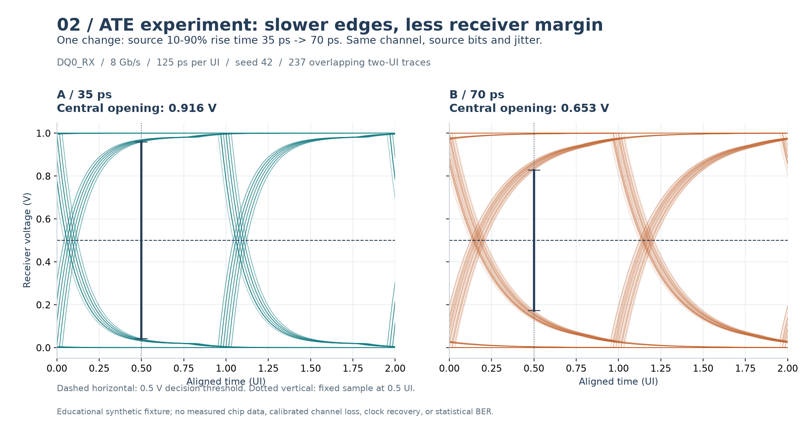
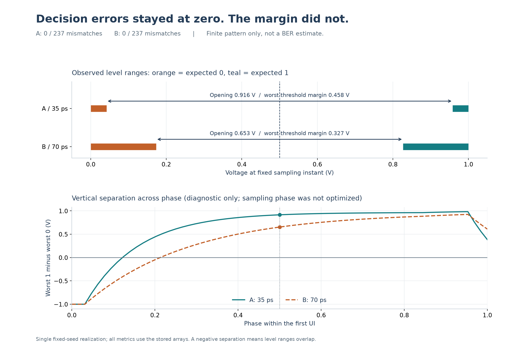

# 실험 02 — 송신 상승 시간을 늘리면 수신 Eye는 어떻게 달라질까?

**2026-11-17 · ATE SI 학습용 수치 실험 · 독립 가상 테스트 보드**

송신 상승 시간만 **35 → 70 ps**로 늘렸더니, 수신 Eye의 중앙 수직 여유가 **0.916 → 0.653 V**로 약 **28.7% 감소**했습니다. 두 조건 모두 이번 237비트에서는 판정 오류가 0개였지만, 임계전압까지의 최소 여유는 **0.458 → 0.327 V**로 줄었습니다. 오류 개수와 신호 여유를 함께 봐야 한다는 것을 보여주는 비교입니다.

이 자료는 AI 에이전트가 기존 Python 모델을 실행·정리한 개인 학습 기록입니다. 실제 ATE 운용·실칩 측정·고객 설비 경험이 아니며, Fab Flow의 GAA/TSV 형상에서 추출한 전기적 특성도 아닙니다.

예약 시각은 한국시간 20:00, 실제 수치 실행은 **2026-11-17 20:03:02 KST**입니다. 입력 계획을 먼저 저장한 뒤 실행했으며, 게시 시각은 이 자료를 추가한 Git 커밋 시각으로 구분합니다. 과거 결과를 다시 포장하지 않았습니다.

## 무엇을 고정하고 무엇을 바꿨나?

[실행 전 계획](plan.json)에 조건·가설·지표를 고정했습니다. 값 탐색, 자동 최적화, 판정 시각 조정은 하지 않았습니다.

| 조건 | A: 기준 | B: 변경 |
|---|---|---|
| 송신 10–90% 상승 시간 `rise_ps` | **35 ps** | **70 ps** |
| 측정 포트 / 모드 | DQ0_RX / Eye | 동일 |
| 데이터율 | 8 Gb/s | 동일 |
| 송신 패턴 | seed 42의 임의 NRZ 256비트 | 동일 비트열 |
| 경계 지터 | 균일분포 ±0.04 UI, 즉 ±5 ps | 동일 난수 이력 |
| 소스 | 0/2 V Thevenin 전압, 내부 저항 50 Ω | 동일 |
| 기판 / 패키지 선로 | 24 mm·50 Ω / 8 mm·65 Ω | 동일 |
| 전파속도 / 수신 종단 | 160 mm/ns / 50 Ω | 동일 |
| 판정 시각 / 임계전압 | 0.5 UI / 0.5 V | 동일 |
| 시간 간격 | 64표본/UI = 1.953125 ps | 동일 |
| Eye 표시 | 앞 16비트 제외 후 완전한 2 UI 파형 237개 중첩 | 동일 |

`decap_nf=10`도 완전한 입력 JSON에 저장되어 있지만, 전원망 PDN 모드용 입력으로 이번 Eye 계산에는 사용하지 않습니다.

여기서 UI는 한 비트의 시간입니다. 8 Gb/s에서는 **1 UI = 125 ps**입니다. 35 ps는 약 0.28 UI, 70 ps는 약 0.56 UI에 해당합니다. `rise_ps`는 **송신 소스의 1차 응답을 정하는 입력**이며, 수신 파형에서 직접 측정한 상승 시간은 아닙니다. 같은 1차 모델이 하강 전이도 느리게 만듭니다.

## 실제 결과

| 지표 | A: 35 ps | B: 70 ps | B − A |
|---|---:|---:|---:|
| 중앙 수직 여유 | 0.916306 V | 0.653491 V | −0.262815 V |
| 1로 보낸 표본 중 최저 전압 | 0.958153 V | 0.826746 V | −0.131407 V |
| 0으로 보낸 표본 중 최고 전압 | 0.041847 V | 0.173254 V | +0.131407 V |
| 0.5 V 임계전압까지의 최소 판정 여유 | 0.458153 V | 0.326746 V | −0.131407 V |
| 유한 패턴의 판정 불일치 | 0 / 237비트 | 0 / 237비트 | 0비트 |
| 실제 표본 정렬 지연 | 201.171875 ps | 201.171875 ps | 0 ps |

이 값들은 장시간 평균이나 여러 시드의 통계량이 아닙니다. 이번에 생성한 단일 패턴에서 구한 최솟값·최댓값과 판정 개수입니다. 원래 정밀도의 값은 [summary.json](data/summary.json)에 있습니다.



검은 세로선은 0.5 UI에서 0 그룹의 최고 전압과 1 그룹의 최저 전압 사이 간격입니다. 주황색 B는 신호가 목표 전압에 접근하는 속도가 느려 이 간격이 좁아졌습니다. 두 그림은 같은 시간·전압 범위를 사용했습니다.



위 그림에서는 주황 구간이 0 그룹, 청록 구간이 1 그룹의 관측 전압 범위입니다. B에서는 두 그룹이 0.5 V 판정선에 더 가까워집니다. 아래 곡선은 저장한 파형에서 위상별로 계산한 수직 분리이며, 이를 이용해 판정 시각을 다시 최적화하지 않았습니다. 음수인 구간은 두 전압 범위가 겹친다는 뜻입니다.

**쉽게 해석하면:** 1을 보낼 때 충분히 높이 올라가기 전에, 또는 0을 보낼 때 충분히 내려가기 전에 판정하게 되어 여유가 줄었습니다. 현재 0.5 V 기준은 아직 넘나들지 않아서 불일치가 없었던 것입니다. 여기에 다른 잡음이나 코너를 더했을 때의 오류 증가는 이번 실험에서 계산하지 않았습니다. “0/237”을 BER=0, 수율 100%, 표준 적합으로 해석하면 안 됩니다.

## 계산 방식과 기호

두 개의 무손실 전송선에서 진행·반사 전압파를 지연 큐로 합산합니다. 소스와 종단의 저항, 선로 사이의 임피던스 차이는 포함하지만, 실제 형상 기반 RLGC 추출이나 전자기장 격자 해석은 아닙니다. 전압은 시간영역의 순간값이며 RMS 값이 아닙니다.

$$T_{UI}=1/R,\qquad \Delta t=T_{UI}/64,\qquad \tau=t_r/\ln(9)$$
$$a=1-e^{-\Delta t/\tau},\qquad v_k=(1-a)v_{k-1}+a u_k$$

- R: 비트율, bit/s. Tᵤᵢ: 1비트 시간, s. Δt: 계산 시간 간격, s.
- tᵣ: 송신 소스의 10–90% 상승 시간, s. τ: 1차 응답의 시정수, s.
- a: 표본별 갱신 계수, 무차원. k: 시간 표본 번호.
- uₖ: 지터가 반영된 이상적 0/2 V 소스. vₖ: 1차 응답을 거친 Thevenin 소스 전압, V. 초기값은 0 V입니다.

이 소스 모델의 명목상 3 dB 주파수는 `1/(2πτ)`로 A 약 9.991 GHz, B 약 4.996 GHz입니다. 이것은 입력 상승 시간에서 **유도한 소스 모델 값**이며 실제 채널·계측기 대역폭을 측정한 값이 아닙니다.

$$H=\min(V_1)-\max(V_0),\qquad M=\min\{\min(V_1)-V_{th},\;V_{th}-\max(V_0)\}$$

- H: 중앙 수직 여유, V. M: 임계전압까지의 최소 부호 있는 여유, V.
- V₁: 원래 비트가 1인 파형들의 **0.5 UI 표본 전압 집합**. V₀: 원래 비트가 0인 표본 전압 집합.
- Vₜₕ: 판정 임계전압 0.5 V. 각 표본이 Vₜₕ 이상이면 1, 미만이면 0으로 판정합니다.

정렬은 명목 송신 클록과 선로 지연만 이용합니다. CDR, 소스 지연 보상, 스트로브 최적화는 없습니다. 선로 지연을 정수 표본으로 반올림해 총 지연이 명목 200 ps에서 201.171875 ps가 되었고, A/B에 동일하게 적용했습니다. 따라서 이번 결론은 **고정된 판정 시각에서의 여유 변화**입니다.

## 검증 범위

**Observed / 실제 확인:**

- A/B의 입력 차이는 `rise_ps` 한 항목뿐입니다. 비트열·경계 지터·시간축이 같고, 같은 시드 재실행 결과가 정확히 일치했습니다.
- 모든 파형의 크기는 237×129이며 유한값입니다. 저장한 파형과 원래 비트열로 수직 여유·판정 불일치를 다시 계산해 모델 출력과 일치함을 확인했습니다.
- 별도의 50 Ω 완전 정합 전송선에서는 `수신 = 지연된 소스 / 2`의 알려진 해와 최대 절대 오차 0 V로 일치했습니다.
- 빠른 상승·무지터·완전 정합의 보조 대조군에서는 수직 여유가 약 1 V, 불일치 0개였습니다.
- 임계전압만 1.9 V로 바꾼 음성 대조군에서는 동일 아날로그 파형에서 불일치가 115개로 증가해 판정 경로가 작동함을 확인했습니다. 이 대조군은 주 비교 A/B와 분리했습니다.
- 기존 전송선·Eye 관련 단위 테스트 2개도 통과했습니다. 그림 2장은 저장한 수치에서 생성하고 축·레이블·겹침을 검토했습니다.

**Inferred / 모델 내 해석:** 송신 전이 속도가 느려지면서 고정된 판정 시점의 1/0 레벨 분리가 감소했습니다. 불일치 개수만으로는 이 여유 감소를 발견하기 어렵습니다.

**Assumed / 가정:** 무손실 전송선, 고정 전파속도, 이상적 공통 접지, 1차 소스 응답, 지정된 균일 지터와 유한 NRZ 임의 패턴입니다. 표준 PRBS 적합 패턴이 아닙니다.

**Unknown / 미검증:** 실칩·실제 ATE와의 정량 일치, 도체·유전체 손실, 크로스토크, 전원 잡음, 여러 시드의 일반성, 시간 간격 수렴, 통계적 BER 및 표준 Eye mask 적합입니다. 이번 자동화는 원래 모델의 고정 64표본/UI를 바꾸지 않았습니다. 구현 검사는 모델의 물리적 정확도 인증과 구분합니다.

## 재실행과 데이터

수치 환경: Python **3.12.2**, NumPy **2.5.3**, SciPy **1.18.1**. 이 폴더에서 아래 명령을 실행합니다. 기존 결과 보호를 위해 비어 있는 출력 폴더를 사용해야 합니다.

```shell
python run_experiment.py --out rerun
python plot_results.py
```

두 번째 명령은 저장된 `data/`를 읽어 그림을 다시 그립니다. 렌더링 환경은 [render_environment.json](figures/render_environment.json)에 별도로 기록했습니다.

- [plan.json](plan.json): 실행 전 조건·가설·지표·소스 해시.
- [source_snapshot/](source_snapshot/): 실제 계산에 사용한 파일의 정확한 사본. `rf_lab` 파일은 기존 공용 입력 검증 함수의 의존성으로 포함되며 RF 실험을 실행하지 않습니다.
- [captures.json.gz](data/captures.json.gz): **전체 원시 JSON의 무손실 gzip 압축본**. A/B 각각의 237×129 파형과 시간축·입력·reading을 모두 포함합니다. 축소하거나 파형을 생략하지 않았습니다.
- [result.json](data/result.json): 실행 ID·시각·환경·입력·요약·검사. 큰 배열은 위 압축본에 있습니다.
- [decision_samples.csv](data/decision_samples.csv): A/B의 판정 표본, 원래 비트, 임계전압과 여유.
- [phase_envelopes.csv](data/phase_envelopes.csv): 첫 UI의 위상별 1 최저·0 최고·분리값.
- [stimulus.json](data/stimulus.json): 원래 비트열, 지터가 반영된 경계 시각, 보존한 원래 비트 인덱스.
- [checks.json](data/checks.json), [manifest.json](manifest.json): 검증 결과·실행 명령·버전·파일 SHA-256.

압축 원본은 Python에서 다음처럼 읽을 수 있습니다.

```python
import gzip, json
with gzip.open("data/captures.json.gz", "rt", encoding="utf-8") as f:
    captures = json.load(f)
```

기존 로컬 작업 트리에 수정·미추적 소스가 있으므로 Git 기준 커밋만으로 사용한 모델을 특정하지 않습니다. **소스 사본과 SHA-256이 재현 기준**입니다. 앱·물리 모델의 수식은 이번 실험에서 수정하지 않았습니다.

다음 ATE 질문: 같은 상승 시간에서 종단 저항만 바꾸면 반사와 수직 여유가 어떻게 달라질까? 아직 수행하지 않은 후속 질문입니다. 일일 주제 순환상 다음 실험은 GAA·자유공정입니다.
