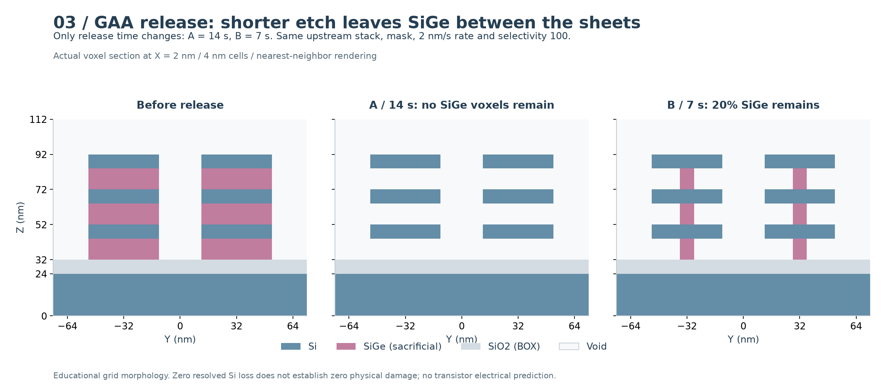
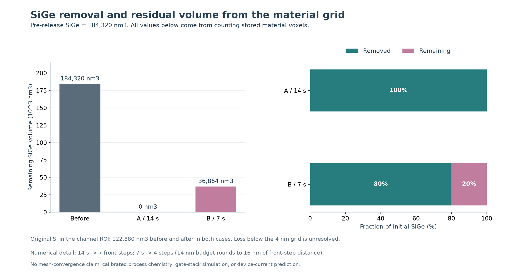
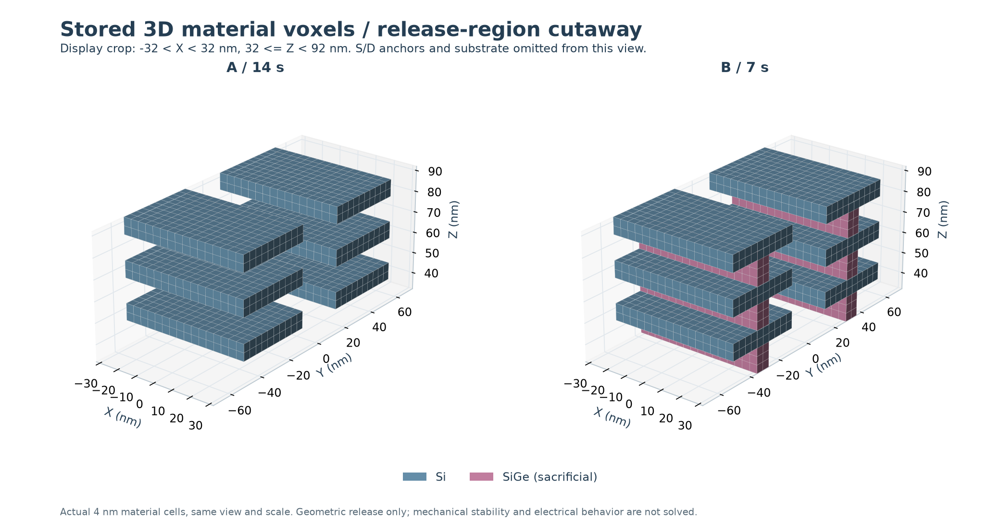

# 실험 03 — GAA 희생층 식각 시간을 줄이면 무엇이 남을까?

**2026-11-18 · GAA/자유공정 개인 학습용 수치 실험 · 3D 재료 격자 모델**

SiGe 선택적 release 시간을 **14초 → 7초**로 줄였더니, 제거 전 184,320 nm³였던 SiGe 중 **36,864 nm³(20%)가 남았습니다.** 14초 조건에서는 같은 격자에 SiGe가 남지 않았습니다. Si 채널 영역의 원래 Si 셀은 두 조건 모두 유지됐지만, 작은 Si 손실은 현재 4 nm 격자로 구분할 수 없습니다.

기존 모델의 공정 순서를 실제로 실행하고 저장된 재료 배열에서 그림과 부피를 만들었습니다. AI 에이전트가 실행·정리한 학습 기록이며 실제 웨이퍼·장비 측정 또는 사용자의 현장 실무 경험을 의미하지 않습니다. 상용 TCAD와의 정량 검증, 완성된 GAA 트랜지스터의 전류·성능 계산은 포함하지 않습니다.

예약 시각은 한국시간 20:00, 실제 계산은 **2026-11-18 20:01:53 KST**에 시작했습니다. 실행 전 [plan.json](plan.json)을 저장했으며, 게시 시각은 이 자료를 추가한 Git 커밋 시각과 구분합니다.

## 실험 질문과 조건

질문은 “동일한 Si/SiGe 적층과 마스크에서 희생층 식각 시간을 절반으로 줄이면, SiGe 잔류량과 Si 보존량이 어떻게 바뀔까?”입니다. 기존 GAA 예시의 14초를 A로 두고 B만 7초로 변경했습니다. 최적 시간을 탐색하거나 결과에 맞춰 조건을 바꾸지 않았습니다.

| 항목 | A: 기준 | B: 변경 |
|---|---|---|
| SiGe release 시간 | **14 s** | **7 s** |
| 대상 / 방식 | SiGe / 등방 격자 식각 | 동일 |
| 대상 속도 / 선택비 | 2 nm/s / 100 | 동일 |
| 연속식의 제거 거리 예산 | 28 nm | 14 nm |
| 모델의 정수 전진 횟수 | 7회 | 4회 |
| 정수 전진 횟수 × 격자 간격 | 28 nm | 16 nm |
| 격자 | 48 × 36 × 48, Δx = 4 nm | 동일 |
| 물리 도메인 | 192 × 144 × 192 nm | 동일 |
| 초기 기판 / BOX / 활성층 | Si 24 nm / SiO₂ 8 nm / 0 nm | 동일 |
| 성장한 적층 | SiGe 12 nm + Si 8 nm를 3회 | 동일 |
| release 개구 | 셀 중심 기준 \|X\| < 32 nm, 전체 Y | 동일 |
| 난수 | 사용하지 않는 결정론적 모델 | 동일 |

공정 순서는 **적층 성장 → mesa 정의 → S/D recess → 이상적 Si anchor 충전 → release 개구 → SiGe 식각 → 계측 기록**입니다. 입력은 총 14단계이며, release 이전의 12단계와 초기 상태는 A/B에서 동일합니다. 계측 단계까지 잘라 실행했으며 후속 gate 증착·도핑·IC Test는 수행하지 않았습니다. 전체 입력은 plan의 `cases`에 있습니다.

## 계산 결과

| 지표 | 식각 전 | A: 14 s 후 | B: 7 s 후 |
|---|---:|---:|---:|
| SiGe 부피 | 184,320 nm³ | **0 nm³** | **36,864 nm³** |
| 초기 SiGe 대비 제거율 | — | 100% | 80% |
| 제거한 SiGe 셀 수 | — | 2,880 | 2,304 |
| 채널 관심 영역의 원래 Si 부피 | 122,880 nm³ | 122,880 nm³ | 122,880 nm³ |

한 셀 부피는 4³ = 64 nm³입니다. B에서 남은 SiGe는 576셀입니다. 이 실험의 모든 SiGe는 정의한 release 관심 영역 안에 있어서 전체 SiGe 부피와 관심 영역의 SiGe 부피가 같습니다.



분홍색이 제거 대상 SiGe, 파란색이 Si입니다. 7초 조건에서는 측면에서 제거가 진행돼도 Si 층 사이 중심부에 SiGe가 남습니다. 14초 조건은 이 계산 격자에서 SiGe가 제거된 상태입니다. 단면은 **X=2 nm**이며, 4 nm 셀 중심 중 선택한 위치입니다. 그림을 부드럽게 보간하지 않았습니다.





3D 그림은 **−32 < X < 32 nm, 32 ≤ Z < 92 nm**만 표시한 단면 영역입니다. 형태를 보기 위해 S/D anchor와 기판을 그림에서 제외했지만 계산에서는 그대로 포함했습니다. 파란 층이 공중에 보이는 것은 표시 영역의 절단 때문입니다. 기계적 안정성이나 처짐은 계산하지 않습니다.

**쉽게 해석하면:** Si 층 사이를 비우기 위해 SiGe를 제거하는데, 시간을 줄이면 안쪽까지 제거하지 못해 희생층이 남는 사례입니다. 이번 모델에서는 7초 조건이 잔류를 보였다는 관찰까지 할 수 있습니다. 14초를 실제 장비의 정답 레시피나 무손상 조건으로 추천하는 결과는 아닙니다.

## 사용한 수식·단위와 중요한 격자 한계

$$d=r\,t,\qquad N_f=\left\lfloor\frac{d}{\Delta x}+0.5\right\rfloor,\qquad V_m=N_m(\Delta x)^3$$

- d: 연속 입력에서 계산한 제거 거리 예산, nm.
- r: 사용자 입력 대상 식각 속도, nm/s. t: release 공정 시간, s.
- Δx: 등방 격자 간격, 4 nm.
- N𝒻: 모델이 수행하는 정수 표면 전진 횟수, 무차원. 내림 기호는 바로 앞 값 이하의 최대 정수를 뜻합니다.
- Vₘ: 재료 m의 부피, nm³. Nₘ: 그 재료 ID를 가진 셀 수, 무차원.

식각은 Z 상단에서 6방향으로 연결된 빈 공간에 닿는 고체 셀에서 시작합니다. 각 전진마다 기체 접근성을 다시 계산하며 XY 마스크 밖의 셀은 보호합니다. 측면 외부 유입과 주기 경계는 없습니다. 배열은 C-order `[X,Y,Z]`, X/Y 중심은 0, Z는 위쪽이 양의 방향입니다.

B의 14 nm 예산은 14/4=3.5셀이라 **4회 전진으로 반올림**됩니다. 이것을 정밀한 14 nm 연속 식각 해석으로 부르면 안 됩니다. A/B 비교는 동일한 4 nm 격자에서 수행한 결과이며, 이번에 격자 수렴 검사는 하지 않았습니다.

제거율과 Si 보존율은 다음처럼 계산했습니다.

$$f_{remove}=100\frac{V_{SiGe,before}-V_{SiGe,after}}{V_{SiGe,before}},\qquad
f_{Si}=100\frac{N_{original\ Si\ retained}}{N_{original\ Si}}$$

- fᵣₑₘₒᵥₑ: 식각 전 SiGe 부피 대비 제거한 비율, %.
- Vₛᵢᴳᵉ,ᵦₑ𝒻ₒᵣₑ / Vₛᵢᴳᵉ,ₐ𝒻ₜₑᵣ: release 직전/직후의 SiGe 부피, nm³.
- fₛᵢ: 정의한 관심 영역에 처음 있던 Si 셀 중 그대로 Si인 셀의 비율, %.
- 관심 영역: 셀 중심 기준 **|X| < 32 nm, Z ≥ 32 nm, 전체 Y**. 이 영역에서 release 직전 Si인 셀을 분모로 사용해 기판 Si를 채널 보존량에 섞지 않았습니다.

**Si 보존율 100%의 한계:** 선택비 S=100에서 단순 비대상 제거 거리 척도 d/S는 A 0.28 nm, B 0.14 nm로 둘 다 4 nm 셀보다 작습니다. 실제 구현은 등방 전진 횟수와 선택비에 따라 비대상 셀을 정수 단위로 제거합니다. 이번 7회/4회에서는 Si 셀 변화가 분해되지 않습니다. 따라서 이 결과는 “격자에서 Si 손실을 관측하지 못했다”는 뜻이며, 원자 수준 손상·거칠기·Si 손실이 없다는 증명이 아닙니다. 원래 모델이 낸 관련 경고도 결과 JSON에 보존했습니다.

## 검증한 것과 남은 불확실성

**Observed / 실제 실행:**

- 입력 차이는 release 단계의 시간 한 항목뿐이며, release 이전의 모든 저장 프레임이 동일했습니다.
- 각 조건을 같은 입력으로 재실행해 전체 결과가 정확히 일치했습니다. 이 모델에는 난수가 없습니다.
- RLE 배열 크기·재료 ID·셀 수와 부피 합계를 확인했습니다. 실제 NPZ 재료 배열과 JSON에 저장한 격자가 일치했습니다.
- release 전후에 새 재료가 생기거나 재료가 다른 고체로 바뀌지 않았고, 마스크 보호 영역도 유지됐습니다.
- release 시간을 0으로 둔 별도 대조군은 직전 형상과 일치했습니다.
- 평면 SiGe에 2셀 제거 예산을 적용한 대조군은 정확히 2층이 제거되는 알려진 결과와 일치했습니다.
- 기존 영입력·release 민감도 관련 단위 테스트 **2개 통과**. 그림 3장은 저장된 실제 수치에서 렌더링하고 축·재료색·범례를 검토했습니다.

**Inferred / 모델 안의 해석:** 짧아진 제거 경로 때문에 중심부 SiGe가 남았습니다. 시간과 잔류량의 관계를 기하적으로 확인한 것이며, 최적 공정 시간을 역산하지 않았습니다.

**Assumed / 가정:** 재료별 상수 속도와 선택비, 정수 격자 표면 전진, 이상적 입력 마스크·S/D 충전, 응력·화학 반응·플라즈마 수송 없는 형상 모델입니다.

**Unknown / 미검증:** 4 nm 이하 손실·표면 거칠기, 격자 수렴, 실제 공정 속도·선택비와의 일치, 응력·처짐·결함, gate 형성과 누설, 전기적 GAA 성능입니다. Poisson/drift-diffusion·양자 수송·실제 TCAD/설비 교정은 수행하지 않았습니다.

## 재현과 원본 파일

수치 계산 환경은 Python **3.12.2**, NumPy **2.5.3**, SciPy **1.18.1**입니다. 이 폴더에서 실행합니다. 기존 결과를 덮어쓰지 않도록 비어 있는 출력 경로가 필요합니다.

```shell
python run_experiment.py --out rerun
python plot_results.py
```

그림 명령은 기존 `data/`를 읽습니다. 그림용 Python·Matplotlib 버전은 [render_environment.json](figures/render_environment.json)에 따로 기록했습니다.

- [plan.json](plan.json): 사전 가설·전체 A/B 레시피·격자·경계조건·소스 해시.
- [source_snapshot/](source_snapshot/): 실제 사용한 변경 없는 모델 파일의 정확한 사본.
- [runs.json.gz](data/runs.json.gz): A/B의 전체 입력·모든 공정 단계 RLE 격자·계측값·경고를 담은 원본 JSON의 무손실 gzip 압축본.
- [A의 최종 NPZ](data/A/final_state.npz), [B의 최종 NPZ](data/B/final_state.npz): 재료·마스크·도핑 및 활성 도핑 배열 전체. 이번 입력에서는 도핑 공정을 수행하지 않았습니다.
- [stage_metrics.csv](data/stage_metrics.csv): 초기 상태와 14단계, 조건별 15개 프레임의 부피·셀 수.
- [sections.npz](data/sections.npz): 그림용 YZ/XZ 단면과 실제 nm 좌표.
- [summary.json](data/summary.json), [result.json](data/result.json), [checks.json](data/checks.json): 결과·실행 ID·시각·환경·검사.
- [manifest.json](manifest.json): 실행 명령·검증 범위·전체 파일 SHA-256.

원래 로컬 작업 트리에 다른 수정·미추적 소스가 있습니다. Git 기준 커밋만으로 최신 로컬 모델을 대표하지 않으므로 재현에는 **포함된 소스 사본과 해시**를 사용합니다. 기존 앱·모델 수식·사용자의 작업 파일은 이번 자동화에서 바꾸지 않았습니다.

다음 GAA 학습 질문은 “같은 물리 도메인에서 격자를 줄여도 SiGe 잔류량 차이가 유지되는가?”입니다. 아직 수행하지 않았으며, 일일 주제 순환상 다음은 **PECVD**입니다.
