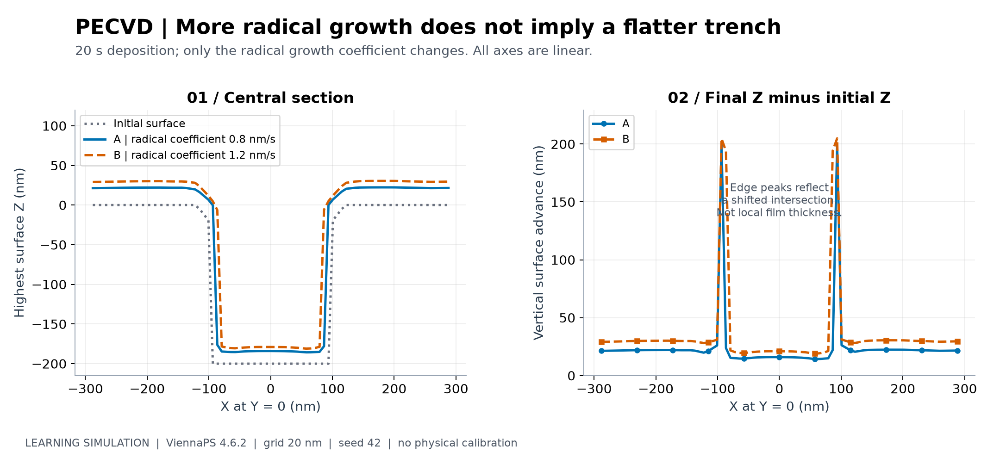
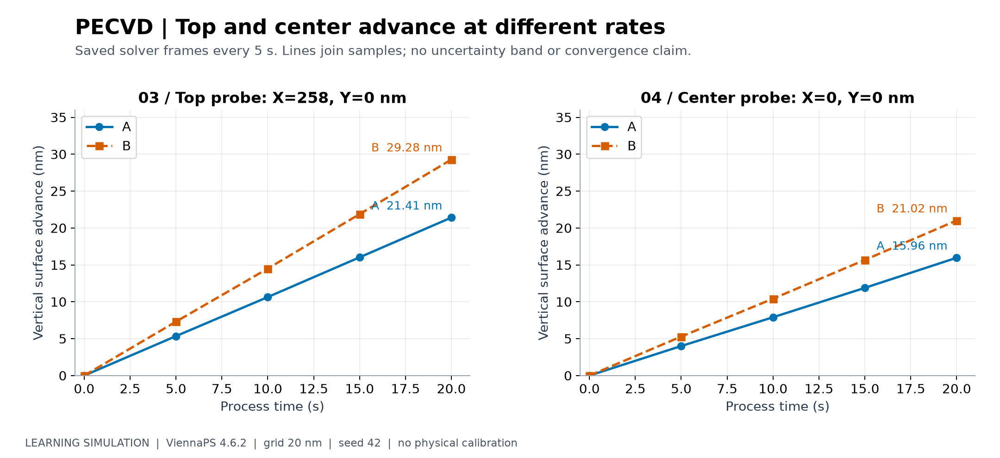
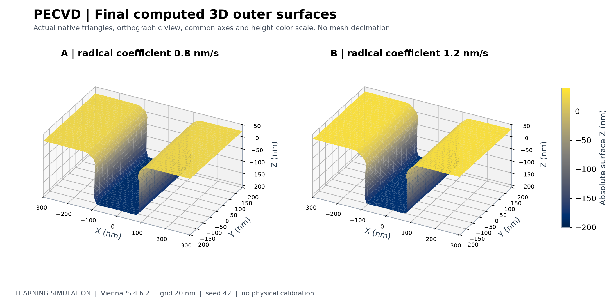

# PECVD 라디칼 성장 계수와 트렌치 표면 변화

**개인 학습용 시뮬레이션 · AI 에이전트 실행. 실제 웨이퍼·설비 측정이나 사용자의 공정 실무 경험이 아닙니다.**

라디칼 성장 계수만 0.8에서 1.2 nm/s로 높였더니, 20초 후 위쪽 표면 이동은 21.41 → 29.28 nm,
바닥 중심 이동은 15.96 → 21.02 nm였습니다.
위쪽과 바닥의 최종 높이 차는 205.45 → 208.26 nm로 증가했습니다.
성장량 증가와 트렌치 평탄화는 서로 다른 평가 항목이라는 것을 이 조건에서 확인합니다.

## 실험 질문과 사전 가설

- 질문: 같은 초기 트렌치와 공정 시간에서 라디칼 성장 계수를 높이면 위쪽과 바닥 중심의 높이가 어떻게 바뀌는가?
- 실행 전 가설: 두 지점의 표면 이동은 커지지만 증가 비율이 같을 필요는 없다.
- [plan.json](plan.json)은 계산 전에 작성했습니다. 결과를 보고 레시피를 탐색하거나 최적화하지 않았습니다.
- 이전 11월 15일 PECVD 실험은 sticking 0.10 → 0.60 비교였습니다. 이번 실험은 다른 변수이며 이전 결과를 재사용하지 않았습니다.
- 예정: **2026-11-20 20:00 KST**. 실제 계산 시작: `2026-11-20T20:06:06.272171+09:00`. 검증 포함 계산 완료: `2026-11-20T20:06:08.601146+09:00`.
- 생성한 실험 ID: `2b89d6349ee94a1ea4af2ab6f0258ca7`. 서버 job ID가 아니라 직접 엔진 호출을 묶는 ID입니다. 각 입력/소스의 `run_hash`는 [execution.json](execution.json)에 있습니다.

## 입력 조건

| 항목 | 기준 A | 변경 B |
|---|---:|---:|
| 라디칼 성장 계수 | 0.8 nm/s | **1.2 nm/s** |
| 이온 보조 성장 계수 | 0.3 nm/s | 동일 |
| sticking 확률 | 0.3 | 동일 |
| 공정 시간 | 20 s | 동일 |
| 초기 트렌치 폭 / 깊이 | 200 / 200 nm | 동일 |
| 계산 영역 X / Y | 600 / 400 nm | 동일 |
| level-set 격자 | 20 nm | 동일 |
| 격자점당 ray 수 / seed | 100 / 42 | 동일 |
| 저장 간격 / 스레드 | 5 s / 1 | 동일 |
| RF 결합 | 꺼짐, 독립 입력 | 동일 |

`radical_rate_nm_s`는 정규화된 국소 라디칼 플럭스에 곱하는 모델 계수입니다. 실제 가스 유량이나 플라즈마 농도를 50% 높였다는 뜻은 아닙니다.
독립 PECVD에서는 `ion_scale=1`이고 입력 이온 보조 계수 0.3 nm/s를 사용합니다. RF/플라즈마 해를 새로 푼 실험이 아닙니다.
전체 정규화 입력은 [inputs/A.json](inputs/A.json), [inputs/B.json](inputs/B.json)에 있습니다.

좌표는 X/Y 수평, Z 위쪽 양수이며 외부 좌표는 nm, 내부 길이는 µm, 시간은 s입니다. X/Y 반사 경계와 Z 무한 경계를 사용합니다.
프레임별 시드는 42, 43, 44, 45입니다. 내부 전진 시간 간격은 CFL 비율 0.4999로 정해지며 개별 내부 시간 간격은 저장되지 않습니다. **5초는 출력 간격**입니다.

## 결과와 계측 정의

`z(x,y,t)`는 해당 XY 위치에서 수직선을 쐈을 때 만나는 **가장 높은 외부 표면의 Z 좌표**입니다.
위쪽 probe는 `(x,y)=(258,0) nm`, 바닥 중심 probe는 `(0,0) nm`입니다.
`Δz = z(20 s) − z(0 s)`, 최종 높이 차는 `z_top(20 s) − z_center(20 s)`로 계산합니다.

| 측정량 | A | B | B − A |
|---|---:|---:|---:|
| 위쪽 수직 표면 이동 Δz (nm) | 21.411773 | 29.275572 | +7.863798 |
| 바닥 중심 수직 표면 이동 Δz (nm) | 15.964720 | 21.015001 | +5.050281 |
| 최종 위쪽–바닥 중심 높이 차 (nm) | 205.447053 | 208.260571 | +2.813517 |

성장 계수는 50% 늘렸지만 위쪽 이동은 36.73%, 바닥 중심 이동은 31.63% 늘었습니다.
이는 고정된 이온 보조 성분과 형상에 따른 수송/표면 진화를 포함한 **이 모델의 계산 결과**입니다. 이 비교만으로 각 기여도를 분리할 수는 없습니다.
높이 차가 증가했으므로 이 두 probe 기준의 트렌치 요철이 줄었다고 말할 수 없습니다. 전체 막 균일도·공정 불량 여부·실제 step coverage 판정은 수행하지 않았습니다.

**Δz를 일반적인 막 두께로 해석하면 안 됩니다.** 특히 개구 가장자리에서는 성장하며 옆으로 이동한 표면 때문에 수직선의 교점이 바닥에서 측벽 근처로 바뀔 수 있습니다.
그래프의 약 200 nm 가장자리 피크는 200 nm 막이 쌓였다는 뜻이 아닙니다. 표면 법선 방향 두께나 묻힌 계면 사이 거리는 별도로 계산해야 합니다.

## 계산 배열에서 만든 그림







단면은 Y=0에서 저장한 81개 XY probe입니다. 직선은 저장 표본을 연결하며 추가 계산점이나 평활화가 아닙니다.
3D 그림에는 실제 외부 SiO2 표면의 모든 삼각형을 사용했습니다(A 2090개, B 2160개). 색은 절대 Z 높이이며 막 두께·플라즈마·입자 궤적이 아닙니다.
시각적인 요철과 ray 잡음을 실물의 물리적 roughness라고 부르지 않습니다. 실제 3D 면은 가림이 있으므로 정량 비교에는 단면과 CSV를 함께 사용하세요.

## 검증

| 검사 | 결과 |
|---|---|
| 정규화 입력에서 성장 계수 하나만 다름 | PASS |
| A 동일 입력 재실행: 전체 프레임 정확히 일치 | PASS |
| 초기 형상 A/B 일치 | PASS |
| 두 성장 계수 0: 초기 SiO2 표면이 그대로 유지 | PASS |
| 알려진 평면의 수직 교점 및 바깥 지점 None | PASS |
| 좌표·probe 유한값, 삼각형 인덱스 범위, 출력 시각 | PASS |
| 초기 Si 기판 메시 보존, 계산 소스 해시 유지 | PASS |
| 기존 schema/평면 probe 단위 테스트 2개 | PASS |
| 격자 수렴, seed 앙상블, 물리 보정, 실제 장비 비교 | NOT_RUN |

검사 원본: [data/validation.json](data/validation.json). A 재실행과 zero-rates는 **보조 검사**이며 A/B 주 비교에 섞지 않았습니다.
결과 소수점 자릿수는 저장 정밀도입니다. 20 nm 공간 격자에서의 수치 해를 실제 nm급 공정 정확도로 주장하지 않습니다.
단일 seed/격자이며 신뢰구간·수렴·최적 레시피를 제시하지 않습니다. 챔버 반응, 공간 플라즈마, 실제 소자 Poisson/drift-diffusion은 풀지 않았습니다.

기존 테스트 명령(원래 프로젝트 루트):
```powershell
.venv/Scripts/python.exe -m unittest studio_lab.tests.test_studio.SchemaTests.test_nonfinite_unknown_and_grid_budget studio_lab.tests.test_studio.SchemaTests.test_vertical_probe_triangle_plane
```

## 재현과 파일

Python 3.12와 [requirements.txt](requirements.txt)의 버전으로 이 폴더에서 실행합니다.
```powershell
python run_experiment.py --out replay
python plot_results.py --data-dir replay
```
첫 명령은 14개 관련 모듈의 `source_snapshot/`을 먼저 import합니다. 새 출력 폴더를 사용하며 기존 수치 결과를 덮어쓰지 않습니다.
그림은 별도 환경의 Python 3.12.14 / NumPy 2.1.3 / Matplotlib 3.11.0으로 생성했습니다. 해당 버전은 그림 재생용이며 계산 엔진용 requirements와 구분합니다.

- `plan.json`, `inputs/`: 계산 전에 고정한 질문·조건·소스 해시.
- `data/*.json.gz`: 네 실행의 **전체 결과 JSON을 무손실 압축**. 저장 프레임의 모든 재료 표면 좌표/삼각형 포함.
- `data/summary.*`, `data/time_series.csv`, `data/sections.csv`: 계산 수치 표.
- `execution.json`: 실제 실행 시간, 실험 ID, 각 실행의 hash, 환경.
- `source_snapshot/`: 이 실행에 필요한 로컬 Python 모듈 사본. 전체 앱 소스가 아닙니다.
- `manifest.json`: 공개 파일 SHA-256 및 로컬에만 남긴 native 파일의 경로/해시.

native VTP와 LVST는 로컬 `native_outputs/`에 보존했고 공개에는 넣지 않았습니다. 전체 표면 프레임은 공개 JSON.gz에 있으나 LVST 내부 level-set 상태의 직렬화 파일 자체는 생략했습니다.
작업트리에는 기존 로컬 수정이 있습니다. 로컬 Git HEAD `e285f328500c5bafcacad4a200cb6dc1b37256f9` 또는 원격 main만으로 같은 엔진 소스가 복원된다고 주장하지 않습니다. 제공한 사본과 해시를 기준으로 재실행합니다.

다음 PECVD 질문: 격자를 줄여도 두 probe의 이동 차이가 유지되는가? **이번에는 수행하지 않았습니다.** 일일 주제 순환상 다음 실험은 **Etch**입니다.
