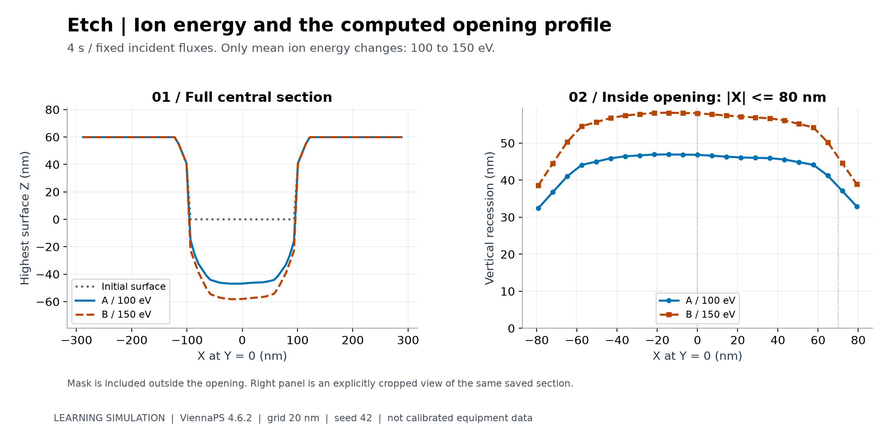
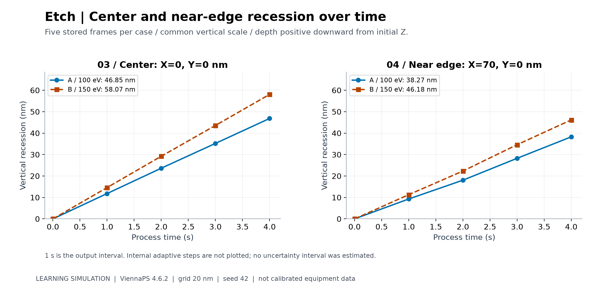
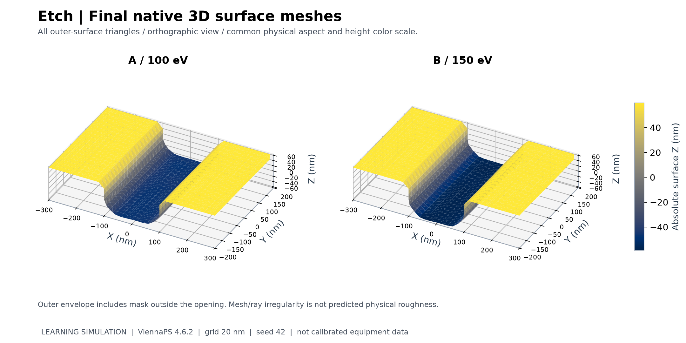

# 실험 05 — 이온 에너지를 높이면 식각 깊이와 위치별 차이는 어떻게 바뀔까?

**개인 학습용 시뮬레이션 · AI 에이전트 실행. 실제 웨이퍼·설비 측정이나 사용자의 현장 공정 경험이 아닙니다.**

평균 이온 에너지만 **100 → 150 eV**로 높였더니, 같은 4초 후 중심 수직 식각 깊이는 **46.85 → 58.07 nm**, 가장자리 안쪽은 **38.27 → 46.18 nm**였습니다.
중심과 가장자리 안쪽의 깊이 차이도 **8.58 → 11.89 nm**로 커졌습니다. 더 깊이 식각되는 것과 두 지점의 깊이가 같아지는 것은 별개의 평가 항목입니다.

## 질문과 계산 전 계획

- 질문: 입사종 플럭스와 공정 시간을 고정했을 때, 이온 평균 에너지가 중심과 가장자리 안쪽의 수직 표면 후퇴에 어떤 영향을 주는가?
- 사전 가설: 이온 에너지 증가로 이온 보조 Si 제거가 증가할 수 있지만 두 위치의 변화량은 같지 않을 수 있다. 방향이 반대거나 차이가 없어도 그대로 기록하기로 했다.
- 질문, A/B 조건, 고정 조건, 측정량은 계산 전 [plan.json](plan.json)에 저장했다. 결과에 맞춘 재탐색·최적화는 하지 않았다.
- 원격 일일 기록은 11월 20일 PECVD까지였으며 이번은 첫 일일 Etch 비교다. 기존 결과를 재사용하지 않았다.
- 예정 시각: **2026-11-23 20:00 KST**. 자동화 호출: **23:03:41 KST**. 실제 계산 시작 `2026-11-23T23:06:00.226714+09:00`, 검증 포함 완료 `2026-11-23T23:06:53.214920+09:00`. 예정 시각에 계산했다고 표현하지 않는다.
- 실험 ID `a538ca6793344f4b9d651a2f48e3cc86`는 직접 엔진 호출에 부여한 ID이며 서버 job ID가 아니다. 개별 `run_hash`와 실제 소요 시간은 [execution.json](execution.json)에 있다. GitHub 게시 시각은 커밋 기록과 별도 로컬 게시 검증 기록을 따른다.

## A/B 입력

| 항목 | A | B |
|---|---:|---:|
| 평균 이온 에너지 | **100 eV** | **150 eV** |
| 이온 에너지 표준편차 | 10 eV | 동일 |
| 식각 시간 | 4 s | 동일 |
| 입사 이온 / F / O 플럭스 | 2 / 800 / 80 × 10¹⁵ cm⁻²s⁻¹ | 동일 |
| 이온 방향성 지수 | 50 | 동일 |
| 개구 폭 / 수치 마스크 높이 | 200 / 60 nm | 동일 |
| 계산 영역 X / Y | 600 / 400 nm | 동일 |
| level-set 격자 | 20 nm | 동일 |
| 격자점당 ray 수 / seed | 100 / 42 | 동일 |
| 저장 간격 / 스레드 | 1 s / 1 | 동일 |
| RF 결합 | 꺼짐, 독립 경계 입력 | 동일 |

사용한 엔진은 기존 `studio_lab.engine.simulate`와 ViennaPS 4.6.2 `SF6O2Etching`이다. 입력 전체는 [A](inputs/A.json), [B](inputs/B.json)에 보존했다.
초기는 마스크 개구 아래 평평한 Si이며 깊이는 0이다. `depth_nm`은 PECVD 단독 초기 형상에만 적용되므로 이번 Etch에는 영향을 주지 않는다. 수치 마스크를 특정 실제 마스크 재료라고 해석하지 않는다.
이온 에너지는 독립 입력이다. RF 전력·전압을 직접 높인 실험이나 sheath/self-bias 계산 결과가 아니다. F/O 플럭스도 챔버 가스 유량에서 추정한 값이 아니다.

외부 길이 단위는 nm, 엔진 내부는 µm, 시간은 s이다. X/Y는 수평, Z는 위쪽이 양수다. X/Y 반사 경계, Z 무한 경계를 사용한다.
`10¹⁵ cm⁻²s⁻¹ = 10¹⁹ m⁻²s⁻¹`이므로 이온 입력 2는 2×10¹⁹ m⁻²s⁻¹이다. 두 조건 모두 프레임별 seed는 42, 43, 44, 45다.
**1초는 출력 간격**이며 내부 시간 간격은 CFL 비율 0.4999로 정해진다. 개별 내부 간격과 coverage 잔차 이력은 내보내지 않는다. coverage 설정은 허용오차 10⁻⁴, 최대 30회이며, 이 설정만으로 모든 내부 수렴을 확인했다고 주장하지 않는다.

## 계측 정의와 결과

`z(x,y,t)`는 저장된 최외곽 삼각형 메시와 수직선의 **가장 높은 교점 Z**다. `d(x,y,t)=z(x,y,0)−z(x,y,t)`로 수직 후퇴량을 계산해 아래 방향 제거가 양수가 되도록 했다.
중심 probe는 `(0,0) nm`, 가장자리 안쪽은 `(70,0) nm`다. 후자는 명목상 +100 nm 개구 경계에서 30 nm 안쪽이며, 20 nm 격자에서 교점 보간에 민감할 수 있다.

| 4초 후 측정량 | A | B | B − A |
|---|---:|---:|---:|
| 중심 수직 후퇴량 (nm) | 46.846691 | 58.068753 | +11.222062 |
| 가장자리 안쪽 수직 후퇴량 (nm) | 38.266475 | 46.182824 | +7.916350 |
| 가장자리 − 중심 후퇴량 (nm) | -8.580216 | -11.885929 | -3.305712 |

에너지는 50% 늘렸으나 중심 후퇴량은 23.95%, 가장자리 안쪽은 20.69% 증가했다. 이는 해당 입력·모델에서 계산된 반응이며 비례 법칙이나 실제 장비의 에너지 민감도라고 일반화하지 않는다.

**Observed:** 두 probe 모두 더 깊어졌고 중심이 가장자리 안쪽보다 더 많이 후퇴했다. **Inferred:** 이 조건에서 에너지를 높이는 것만으로 두 지점의 깊이 차이가 줄어들지는 않았다.
공정 목표 깊이·CD·측벽각·허용 손상량을 설정한 실험은 아니므로 A/B의 합격·불합격 또는 최적 레시피를 판정하지 않는다. 두 점의 차이를 웨이퍼 전체 균일도나 전체 바닥 거칠기로 바꾸어 부르지 않는다.

## 실제 배열에서 생성한 그림



왼쪽은 개구 밖 마스크까지 포함한 전체 단면이다. 오른쪽은 같은 저장 단면 중 |X|≤80 nm 구간을 명시적으로 표시한다. 추가 점을 계산하거나 평활화하지 않았다. 점선은 X=0,70 nm probe 위치다.



0,1,2,3,4초의 실제 저장 프레임이다. 선은 저장 표본 연결이며 내부 세부 시간 해 또는 신뢰구간이 아니다.



각 조건의 최외곽 메시 삼각형 1520개를 모두 표시했다. 직교 투영과 실제 좌표 비율을 사용하며 색은 절대 Z 높이다. 개구 밖에는 마스크가 포함된다. 시각적인 삼각형·ray 요철을 실제 물리적 roughness나 불량으로 해석하지 않는다. 3D의 가려진 부분은 단면과 CSV로 함께 확인한다.

## 검증과 한계

| 검사 | 상태 |
|---|---|
| 정규화 입력 차이: 이온 에너지 하나만 변경 | PASS |
| A/B 초기 형상 일치 | PASS |
| A 동일 조건 재실행: 전체 프레임 정확히 일치 | PASS |
| 0초 대조군: 초기 형상 그대로 유지 | PASS |
| 알려진 평면의 교점·영역 밖 None | PASS |
| 메시/단면/probe 유한값과 삼각형 인덱스 범위 | PASS |
| 출력 시간축·입사 플럭스 단위 변환 | PASS |
| 계산 전후 관련 소스 해시 유지 | PASS |
| 기존 평면 probe·플럭스 단위 테스트 2개 | PASS |
| 격자 수렴·seed 앙상블·실제 장비 보정 | NOT_RUN |
| coverage 잔차 이력 | NOT_EXPORTED |

검사 원본은 [validation.json](data/validation.json), 실제 실행한 단위 테스트 기록은 [unit_test_record.json](data/unit_test_record.json)이다.
재실행·0초 대조군은 A/B 주 비교와 분리한 보조 검사다. 0초 검사는 엔진의 무진행 경로이며 영 플럭스에서의 표면 반응이나 화학적 정확성을 검증하지 않는다.
20 nm 단일 격자·단일 seed이므로 소수점 자릿수는 저장 정밀도다. nm급 물리 정확도나 통계적 유의성은 입증하지 않았다. 챔버 화학·공간 플라즈마·sheath·Si 결함·소자 Poisson/drift-diffusion은 풀지 않았다.

## 재현 및 파일

Python 3.12와 [requirements.txt](requirements.txt)의 계산 패키지를 사용한다. 이 폴더에서 새 경로로 실행한다.

```shell
python run_experiment.py --out replay
python plot_results.py --data-dir replay
```

첫 명령은 포함된 관련 모듈 14개의 `source_snapshot/`을 사용한다. 그림은 별도 환경의 Python 3.12.14 / NumPy 2.1.3 / Matplotlib 3.11.0으로 생성했다. 그림용 버전과 계산 엔진용 버전은 구분한다.

- `plan.json`, `inputs/`: 실행 전 질문·조건·측정 정의·소스 해시.
- `data/*.json.gz`: 네 실행의 전체 입력·출력 프레임·모든 재료 표면 메시를 무손실 압축한 원본.
- `data/summary.*`, `time_series.csv`, `sections.csv`: 계산 결과 표.
- `execution.json`: 실제 시각·실험 ID·각 run hash·환경.
- `source_snapshot/`: 해당 실행이 사용한 변경 없는 로컬 모듈 사본. 전체 앱 소스가 아니다.
- `manifest.json`: 실행·검증·그림 검토 기록과 공개 파일 SHA-256.

native VTP/LVST는 로컬 `native_outputs/`에 보존하고 공개에서는 생략했다. 표면 좌표는 공개 gzip에 모두 있으며 LVST 내부 level-set 직렬화는 공개하지 않았다. 생략 파일 해시는 manifest에 기록했다.
기존 작업 트리에는 수정·미추적 코드가 있다. 로컬 Git HEAD `e285f328500c5bafcacad4a200cb6dc1b37256f9` 또는 원격 커밋만으로 모델을 완전히 재현할 수 있다고 주장하지 않는다. 제공한 소스 사본과 해시가 재현 기준이다. 이번에는 앱이나 모델 수식을 수정하지 않았다.

다음 확인할 Etch 질문: 같은 도메인에서 격자를 줄여도 중심–가장자리 깊이 차이가 유지되는가? 아직 실행하지 않았다. 일일 주제 순환상 다음은 **TSV·공정순서 비교**다.
