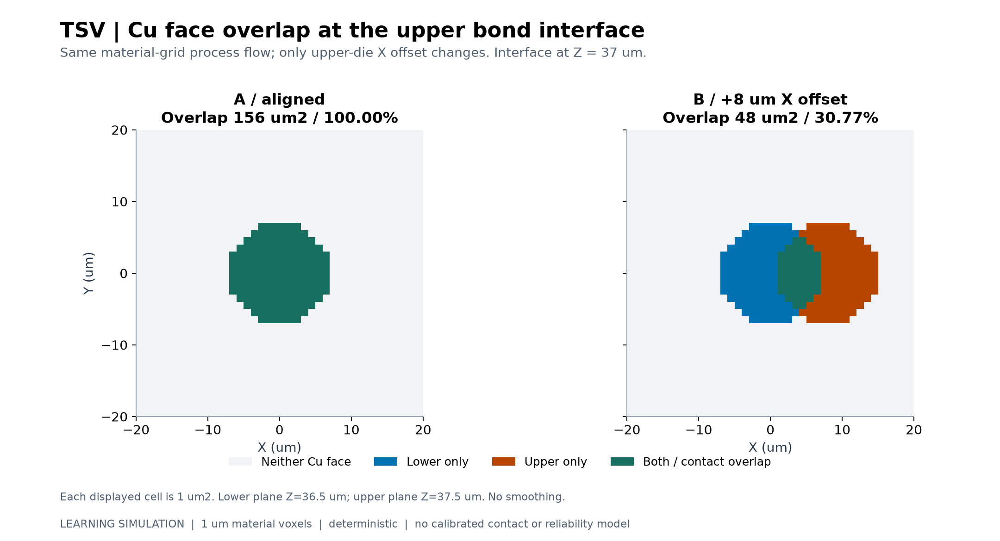
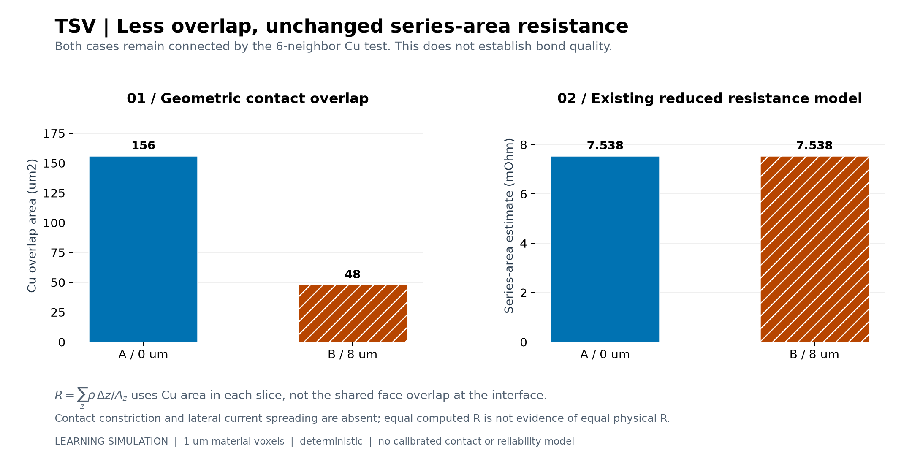
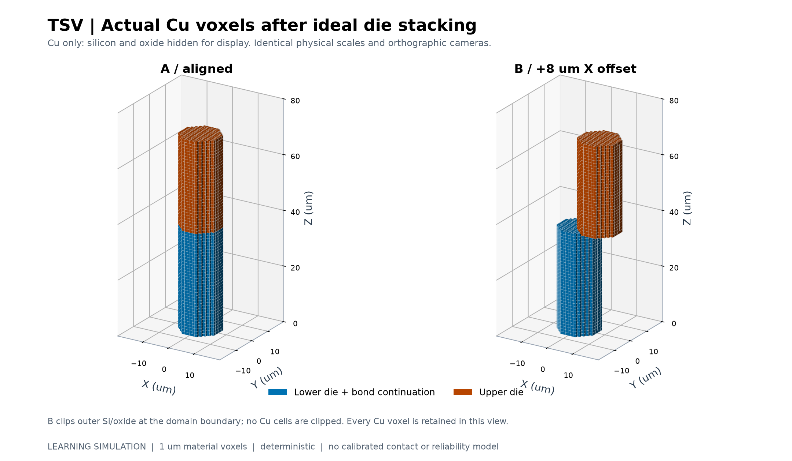

# 실험 06 — TSV 정렬 오차: 연결 PASS가 접합 품질까지 뜻할까?

**개인 학습용 시뮬레이션 · AI 에이전트 실행. 실제 웨이퍼·본딩 장비·ATE 측정 또는 사용자의 현장 실무 경험이 아닙니다.**

위 다이의 X 정렬 오차만 **0 → 8 µm**로 바꿨다. Cu 접합면의 겹침 면적은 **156 → 48 µm²**로 줄었지만, 두 조건 모두 구리 관통 경로가 연결된 것으로 판정됐다.
기존 저항 추정치도 두 조건 모두 **7.538462 mΩ**였다. 이는 접합 상태가 동등하다는 뜻이 아니다. 현재 단면적 기반 직렬 저항식은 접합면의 전류 집중·횡방향 전류 퍼짐·접촉 저항을 포함하지 않는다.

## 질문과 실행 기록

- 질문: 정렬 오차가 Cu 면 겹침, 관통 연결성, 현재 구현된 저항 추정치에 각각 어떤 영향을 주는가?
- 사전 가설: 겹침은 줄어도 연결 상태는 유지될 수 있다. 단면적 기반 저항은 접합부 영향을 생략하므로 변하지 않을 수 있다. 결과와 관계없이 사전 조건을 유지하기로 했다.
- [plan.json](plan.json)에 질문·가설·A/B 조건·측정량·소스 해시를 계산 전에 기록했다. 결과를 본 후 유리한 조건을 탐색하지 않았다.
- 기존 단위/UI 검사에는 0 대 16 µm 정렬 오차 비교가 있었다. 이번은 0 대 8 µm를 새로 실행한 첫 일일 TSV 실험이며 과거 수치를 재사용하지 않았다.
- 예정 **2026-11-24 20:00 KST**, 실제 계산 시작 `2026-11-24T20:00:40.764508+09:00`, 검증 포함 완료 `2026-11-24T20:00:41.114305+09:00`. 자동화 호출은 19:57:08 KST였고 사전 확인 후 20시가 지나 계산했다. 게시 시각은 커밋 및 별도 게시 검증 기록을 따른다.
- 실험 ID `812a0f172db5428d9543daed2a5c0ce5`는 직접 함수 호출에 부여한 별도 ID다. 서버 job ID가 아니다. A/B 및 재실행 시각과 입력 hash는 [execution.json](execution.json)에 있다.

## 입력과 공정 순서

기존 `fab_lab.presets`의 TSV 흐름을 `fab_lab.engine.simulate`로 실행했다. **공정 순서는 두 조건에서 동일**하며 이번 변경 변수는 bond 단계의 X 오프셋 하나다.

**TSV 개구 입력 → Si 방향성 식각 → 마스크 해제 → 이상적 SiO₂ liner → Cu fill 개구 → 이상적 Cu 충전 → 단일 TSV 계측 → 이상적 적층 → 적층 계측 → Cu 관통 검사**

| 항목 | A | B |
|---|---:|---:|
| 위 다이 X 오프셋 | **0 nm** | **8000 nm = 8 µm** |
| Y 오프셋 / 접합층 높이 | 0 / 4000 nm | 동일 |
| 초기 Si 기판 두께 | 32000 nm | 동일 |
| TSV 개구 지름 | 16000 nm | 동일 |
| Si 식각 속도 / 시간 | 1000 nm/s / 32 s | 동일 |
| liner cycles / GPC / exposure / k | 10 / 100 nm·cycle⁻¹ / 20 Pa·s / 1 (Pa·s)⁻¹ | 동일 |
| Cu fill 명목 지름 / 상단 Z | 14000 / 33000 nm | 동일 |
| Cu 비저항 입력 ρ | 1.68×10⁻⁸ Ω·m | 동일 |
| 격자 / 셀 수 | 1000 nm / 40×40×80 | 동일 |
| 물리 도메인 | 40×40×80 µm | 동일 |
| 난수 seed | 없음: 결정론적 모델 | 동일 |

전체 정규화 입력은 [inputs/A.json](inputs/A.json), [inputs/B.json](inputs/B.json)에 있다.
liner 두께는 구현된 흡착 포화식으로 약 1000 nm가 되어 한 격자층으로 표현된다. 여기의 GPC 등은 µm 규모의 거친 형상 예시 계수이며 실제 ALD 레시피·성장률을 권장하는 값이 아니다.
fill은 지정 높이 이하의 빈 셀을 채우는 연산이다. 핵생성·도금·void 형성 동역학은 생략한다. bond는 현재 구조를 위로 복제하고 아래 다이의 Cu footprint를 접합층에 연장하는 이상적 연산이다.

좌표는 C-order `[X,Y,Z]`, X/Y 중심은 0, Z는 위로 증가한다. 내부 길이는 nm이며 그림만 µm로 환산했다. 난수·Monte Carlo 표본은 없다.
프레임은 초기 상태와 10개 공정 단계의 총 11개다. **단계 번호는 경과 시간이 아니다.** 32초는 식각 입력이며 적층/충전의 연속 시간 해를 계산하지 않는다. 측면 주기 경계는 없고 기체 접근성은 상단에 연결된 6방향 빈 셀로 판정한다.

## 가상 계측 정의

접합면은 **Z=37 µm**다. 바로 아래 셀 중심 Z=36.5 µm와 바로 위 셀 중심 Z=37.5 µm에서 같은 XY 위치가 모두 Cu이면 접합면 겹침 한 셀로 센다.

`A_overlap = N_shared × (Δx)²`, `overlap_% = 100 × A_overlap / A_lower`.

- A_overlap: 기하학적 Cu 겹침 면적, nm².
- N_shared: 두 인접 Z 슬라이스가 함께 Cu인 XY 셀 수, 무차원.
- Δx: 격자 간격 1000 nm. 셀 한 면은 10⁶ nm² = 1 µm².
- A_lower: 아래 Cu pad의 격자 면적, 156×10⁶ nm² = 156 µm².
- overlap_%: 아래 pad를 기준으로 한 겹침 비율, %.

연결성은 바닥과 최상단 고체 평면을 동시에 만나는 **6방향 Cu 연결 성분** 유무다. 실제 접합 강도·누설·내구성·전류 허용량 판정이 아니다.

저항은 기존 `fab_lab.electrical.copper_path`의 `R = Σ_z ρ Δz / A_z`다.

- R: 단면적 기반 직렬 저항 추정치, Ω.
- ρ: 입력 Cu 비저항, 1.68×10⁻⁸ Ω·m. 이번 막에서 측정한 값이 아니다.
- Δz: 한 셀 높이 1000 nm = 10⁻⁶ m.
- A_z: 관통 연결 성분에 속하는 Cu의 해당 Z 슬라이스 면적, m².
- 합은 구조의 최하단부터 최상단까지 수행한다. 이번 두 경우 경로 길이는 70 µm이며 각 슬라이스 Cu 면적은 156 µm²다.

**A_z는 접합면 겹침 A_overlap과 다르다.** 오프셋으로 두 슬라이스 사이의 접촉 면이 줄어도 각 슬라이스 Cu 면적은 그대로일 수 있다. 이 식은 횡방향 전류 경로·spreading/contact 저항을 풀지 않는다. 불연결이면 저항은 0이 아닌 `null`이다.

## 결과와 해석

| 지표 | A: 정렬 | B: +8 µm |
|---|---:|---:|
| Cu 접합면 겹침 (µm²) | 156 | 48 |
| 아래 pad 기준 겹침 비율 (%) | 100.00 | 30.77 |
| 6방향 Cu 관통 연결 | 연결 | 연결 |
| 단면적 기반 저항 (mΩ) | 7.538462 | 7.538462 |
| 최종 Cu 부피 (µm³) | 10920 | 10920 |

**Observed:** 겹침 면적이 69.23% 감소했고 연결 여부와 현재 저항 추정치는 같았다. 각 조건의 전체 출력은 동일 입력 재실행에서 정확히 일치했다.
**Inferred:** 이 모델의 연결 PASS 또는 저항 숫자 하나만으로 접합 형상이 동일하다고 결론 내릴 수 없다. 겹침 면적처럼 다른 관측량을 함께 확인해야 한다.
**Unknown:** 두 조건의 실제 접촉 저항·전류 집중·온도 상승·접합 신뢰성 차이는 이 실험으로 결정할 수 없다. 실제 저항이 같다고 주장하지 않는다.

## 계산 영역과 잘림

B에서 위 다이를 +8 µm 이동하면서 경계 밖의 **Si 10,240셀, SiO₂ 320셀**이 잘렸다. 모델의 경고를 원본에 보존했다. **Cu 잘림은 0셀**이며 Cu 부피와 각 pad 면적은 A/B에서 동일하다.
따라서 이 비교는 계산 영역 안의 Cu 연결과 겹침을 다루며, 전체 위 다이 재료 부피를 보존한 무한영역 이동으로 해석하면 안 된다. Si/oxide 경계 변화가 현실의 열·기계·전기 거동에 미칠 영향도 현재 모델은 계산하지 않는다.

## 실제 데이터에서 생성한 그림







3D는 저장된 Cu 셀을 모두 사용하며 생성 이미지나 매끈한 가상 형상으로 대체하지 않았다. Si/SiO₂는 표시에서만 숨겼다. 동일 축·직교 카메라·물리 좌표 비율을 사용한다. 격자 모서리를 실제 거칠기로 해석하지 않는다.

## 검증

| 검사 | 결과 |
|---|---|
| 입력 차이는 bond X offset 하나 | PASS |
| bond 이전의 모든 저장 프레임 동일 | PASS |
| A/B 각각 전체 결과 정확 재실행 | PASS |
| 재료 RLE 크기·ID·셀 수·부피, 저장 NPZ와 일치 | PASS |
| 아래 다이 보존, 위 다이 정수 이동, 접합층 Cu footprint | PASS |
| Cu 잘림 없음·복제/접합층을 포함한 Cu 부피 계산 | PASS |
| 알려진 균일 Cu 기둥의 R=ρL/A와 일치 | PASS |
| Cu 기둥을 끊은 대조군: 불연결·저항 null | PASS |
| 기존 알려진 저항/단선 및 bond 연결성 단위 테스트 2개 | PASS |
| 격자 수렴·실제 장비 보정 | NOT_RUN |
| 접촉/spreading 저항·응력·열·추출된 SI/PI | NOT_MODELED |

검사 원본: [validation.json](data/validation.json), [controls.json](data/controls.json), [unit_test_record.json](data/unit_test_record.json).
72개의 저장 상태/일관성 검사는 72번의 독립 실험이나 물리 검증을 뜻하지 않는다. 1 µm 단일 격자의 원형 단면은 셀 면적으로 표현되며 연속 원 면적과 다를 수 있다. 격자 이하 정밀도나 실제 수율을 주장하지 않는다. MOS compact 결과는 이번 TSV 출력에 포함되지 않는다.

## 재현과 자료 구성

Python 3.12 및 [requirements.txt](requirements.txt)의 NumPy/SciPy 버전으로 이 폴더에서 실행한다. 기존 결과를 덮어쓰지 않도록 새로운 출력 경로를 사용한다.

```shell
python run_experiment.py --out replay
python plot_results.py --data-dir replay
```

계산은 `source_snapshot/`의 관련 모듈 5개를 import한다. 그림 생성 환경은 Python 3.12.14 / NumPy 2.1.3 / Matplotlib 3.11.0으로 별도 기록했다. 모델 코드·수식·앱은 이번에 바꾸지 않았다.

- `plan.json`, `inputs/`: 사전 질문·조건·고정값·측정 정의.
- `data/A.json.gz`, `B.json.gz`: 전체 요청·모든 단계 RLE 재료 격자·계측·검사·경고.
- `data/A/final_state.npz`, `data/B/final_state.npz`: 원래 엔진이 저장한 전체 재료/마스크/도핑 배열. 이번에는 도핑 공정을 수행하지 않았다.
- `summary.json/csv`, `stage_metrics.csv`, `cu_area_by_z.csv`: 결과와 단계·Z별 수치.
- `sections.npz`: 실제 XZ 단면 및 접합면 footprint 배열. 단면 Y=0.5 µm.
- `execution.json`, `manifest.json`: ID·시각·환경·source SHA-256·명령·파일 해시.

로컬 HEAD `e285f328500c5bafcacad4a200cb6dc1b37256f9`에는 기존 수정/미추적 소스가 있어 원격 Git SHA만으로 최신 모델을 복원할 수 있다고 주장하지 않는다. 포함된 소스 사본과 해시가 재현 기준이다. 이번 작은 원본 산출물은 모두 공개 목록에 포함했고 생략한 native 결과 파일은 없다.

다음 TSV 질문: 동일한 물리 영역에서 격자를 줄여도 겹침 면적 감소 비율이 유지되는가? 아직 실행하지 않았다. 주제 순환상 다음은 **RF 임피던스·매칭**이다.
