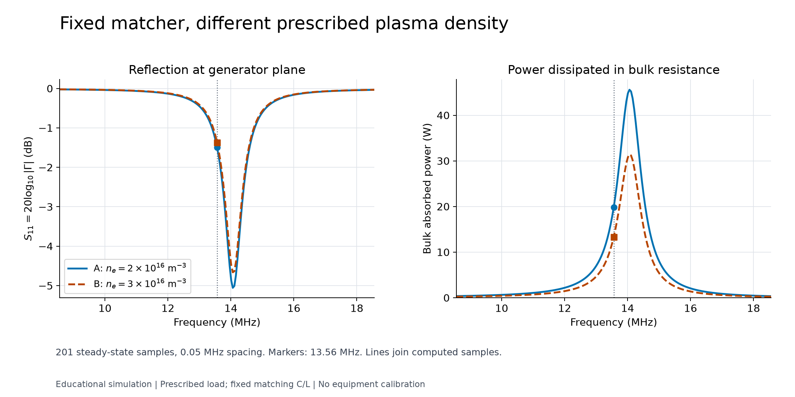
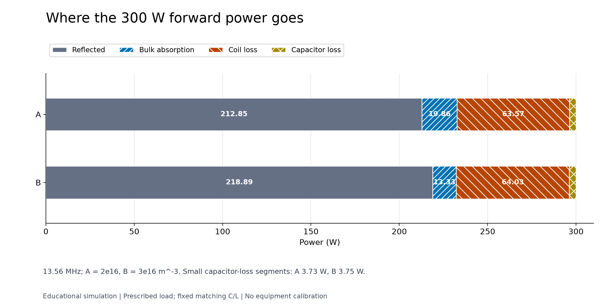
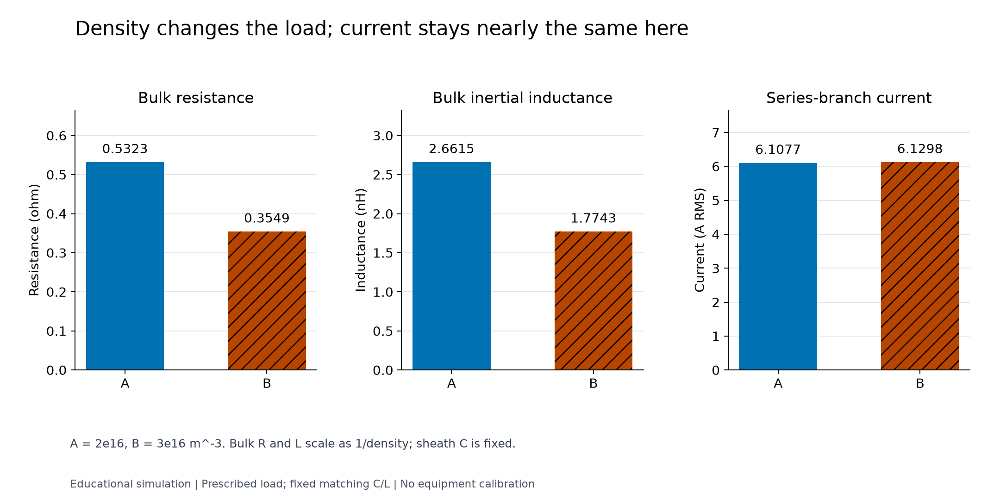

# 실험 07 — 고정 매칭 회로에서 처방 전자밀도 변경

**개인 학습용 시뮬레이션 · AI 에이전트 실행. 실제 플라즈마 관측, 웨이퍼·설비 측정 또는 사용자의 실무 경험이 아닙니다.**

합성 부하의 전자밀도를 2×10¹⁶ → 3×10¹⁶ m⁻³로 지정하고 매칭 소자는 고정했다.
13.56 MHz에서 반사 전력 비율은 70.95 → 72.96%, 벌크 흡수 전력은 19.86 → 13.33 W였다.
밀도가 커진다는 조건만으로 흡수 전력이 증가한다고 결론 낼 수 없다는 이 등가회로의 사례다.

## 실행 전 질문과 조건

질문: 매칭 C/L을 고정한 상태에서 처방 전자밀도만 바꾸면 임피던스·반사·벌크 흡수·소자 손실이 어떻게 달라지는가?
가설: 같은 기하와 충돌 빈도에서 밀도 1.5배는 벌크 R/L을 2/3로 줄인다. 전력 전달의 변화 방향은 회로를 풀어 확인한다.
[plan.json](plan.json)에 질문·입력·주요 측정량을 실행 전에 저장했다. 결과에 맞춘 재탐색이나 자동 정합은 수행하지 않았다.

| 항목 | A | B |
|---|---:|---:|
| 처방 전자밀도 nₑ | 2×10¹⁶ m⁻³ | **3×10¹⁶ m⁻³** |
| 동작 주파수 / 순방향 전력 | 13.56 MHz / 300 W | 동일 |
| 병렬 Cₚ / 직렬 Cₛ / 코일 L | 500 pF / 120 pF / 2 µH | 동일 |
| 코일 Q / 커패시터 Q | 100 / 1000 | 동일 |
| 유효 충돌 빈도 ν | 2×10⁸ s⁻¹ | 동일 |
| 벌크 길이 / 유효 면적 | 30 mm / 200 cm² | 동일 |
| 두 sheath 두께 합 | 1 mm | 동일 |
| 무손실 50 Ω 급전선 길이 / 속도 계수 | 0.5 m / 0.7 | 동일 |

전체 입력은 [A](inputs/A.json), [B](inputs/B.json)다. `density_ratio`, `voltage_limit_v`, `current_limit_a`는 공통 schema에 있으나 이번 point 계산에는 사용하지 않는다.
전자밀도는 이 실험에서 지정하는 부하 상태다. 실제 장비에서 RF 전력이나 가스 유량을 조절해 달성한 값이 아니며 압력·가스 유량과의 변환은 수행하지 않았다.

예정 시각은 **2026-11-26 20:00 KST**, 자동화 호출은 **20:02:54 KST**였다.
실제 계산 시작은 `2026-11-26T20:04:45.817079+09:00`, 보조 검증 포함 완료는 `2026-11-26T20:04:45.927654+09:00`다.
실험 ID `3871ff9645814d35880e7a6ef3e10e72`는 직접 함수 호출을 묶기 위해 생성했으며 서버 job ID가 아니다.
게시 완료 시각은 GitHub 커밋과 별도 로컬 게시 영수증으로 구분한다.

공개 완료 이력의 직전 주제는 TSV다. 11월 25일 코일 인덕턴스 비교는 로컬 계산만 확인되어 오늘 결과로 재포장하지 않았다.
오늘은 새로운 밀도 비교이며 동일한 A 기준 조건도 새로 계산했다. 과거 결과 재사용은 없다.

## 모델과 수치 규약

회로는 `50 Ω 발생기 → 무손실 50 Ω 선로 → 병렬 Cₚ 및 직렬 L–Cₛ–플라즈마 Rᵦ/Lᵦ/Csh 가지`다.
기존 `rf_lab.model.validate`로 입력을 확인하고 `point`를 호출했다. 자동 최적화를 포함하는 `simulate`/`tune`은 호출하지 않았다.

```text
Lᵦ = mₑ ℓᵦ / (nₑ e² A),     Rᵦ = ν Lᵦ
Csh = ε₀ A / (s₁+s₂),         Zload = Rᵦ + jωLᵦ + 1/(jωCsh)
Γ = (Zin − Z₀) / (Zin + Z₀),  S11[dB] = 20 log10|Γ|
Pref = Pfwd |Γ|²,              Pbulk = |Ibulk,RMS|² Rᵦ
Pfwd = Pref + Pbulk + Pcoil + Pcapacitors
Rcoil = ωL/Qcoil,              ESRcapacitor = 1/(ω C Qcapacitor)
```

- nₑ: 처방 전자밀도 [m⁻³], ν: 전자 운동량 손실의 유효 충돌 빈도 [s⁻¹].
- mₑ: 전자 질량 [kg], e: 기본 전하량 [C], ε₀: 진공 유전율 [F/m]. 상수는 소스에 보존했다.
- ℓᵦ: 벌크 길이 [m], A: 유효 전극 면적 [m²; 여기서는 조건 이름 A와 별개], s₁+s₂: 두 sheath 두께 합 [m].
- Lᵦ/L: 벌크/매칭 인덕턴스 [H], Rᵦ/Rcoil/ESR: 저항 [Ω], C/Csh: 커패시턴스 [F], Q: 무차원 품질계수.
- f: 주파수 [Hz], ω=2πf [rad/s], j²=−1, Zin: 발생기 기준면 입력 임피던스 [Ω], Z₀=50 Ω, Γ: 무차원 복소 반사계수.
- Pfwd/Pref/Pbulk/Pcoil/Pcapacitors: 각각 순방향/반사/벌크/코일/커패시터 전력 [W], Ibulk,RMS: 벌크 가지 RMS 전류 [A].

페이저는 exp(+jωt), 전압·전류는 RMS, 내부 단위는 SI다. RMS 전력에 1/2를 추가하지 않는다.
주 비교는 정확히 13.56 MHz다. 부가 응답은 8.56~18.56 MHz, 0.05 MHz 간격의 **201개 독립 정상상태 해**다.
주파수축은 시간축이 아니다. 공간 격자·시간 적분 간격·난수 seed는 없으며 각각 null로 기록했다.
균일한 처방 부하와 고정 선형 sheath, 무손실 선로, 주파수에 무관한 유한 Q를 가정한다.

## 13.56 MHz 결과

| 지표 | A | B | B − A |
|---|---:|---:|---:|
| 벌크 저항 (Ω) | 0.532304 | 0.354869 | -0.177435 |
| 벌크 인덕턴스 (nH) | 2.661518 | 1.774346 | -0.887173 |
| 반사 전력 비율 (%) | 70.950341 | 72.963633 | +2.013293 |
| 반사 전력 (W) | 212.851022 | 218.890900 | +6.039878 |
| 회로가 받아들인 전력 (W) | 87.148978 | 81.109100 | -6.039878 |
| 벌크 저항 흡수 전력 (W) | 19.857207 | 13.333818 | -6.523389 |
| 코일 손실 (W) | 63.566491 | 64.025925 | +0.459434 |
| 커패시터 손실 (W) | 3.725280 | 3.749357 | +0.024077 |
| 직렬 가지 전류 (A RMS) | 6.107723 | 6.129756 | +0.022032 |
| 순방향 대비 벌크 흡수 비율 (%) | 6.619069 | 4.444606 | -2.174463 |

반사 전력 비율 차이 2.013293는 **퍼센트포인트**다.
벌크 흡수 전력은 -32.85% 변했다.
부하 임피던스는 A `0.532304 − j66.053119 Ω`, B `0.354869 − j66.128706 Ω`다.
발생기 기준면의 입력 임피던스는 각각 `4.924191 + j19.326709 Ω`, `4.521110 + j19.285073 Ω`다.

**Observed:** 벌크 R/L은 2/3로 감소하고 가지 전류는 6.1077 → 6.1298 A RMS로 조금 증가했다. 벌크 전력은 감소하고 반사·코일 손실은 증가했다.
**Inferred:** 이 조건에서 |I|²의 작은 증가가 Rᵦ 감소를 상쇄하지 못해 벌크 소산이 줄었다. 고정 매칭 회로에서 부하 상태 변화와 전력 전달을 함께 봐야 한다.
**Unknown:** 실제 장비에서 밀도를 바꿨을 때의 결과, 가스 반응·온도·sheath 자기일관성·공정 성능은 이 계산으로 결정할 수 없다.

`Pfwd−Pref`는 회로 전체가 받아들인 전력이다. 코일·커패시터 손실을 포함하므로 이를 모두 플라즈마 흡수라고 부르지 않는다.
주파수 표본 중 최소 반사는 두 경우 모두 14.06 MHz에서 나타났지만, 이는 고정된 201개 표본 내 최소값이다. 연속 최적 주파수·최적 레시피 또는 변경 권장 주파수가 아니다.

## 실제 배열로 생성한 그림







그림은 저장 배열만 사용한다. 평활화·추가 보간 표본·신뢰구간은 없고 선은 실제 계산점을 연결한다. 색과 선 형태/해칭을 함께 사용했다.

## 검증과 한계

| 검사 | 결과 |
|---|---|
| 정규화 A/B 입력에서 전자밀도 하나만 다름 | PASS |
| 각 조건 201점 전체 정확 재실행 일치 | PASS |
| 유한값·수동성·전력 분해·진폭/전력 반사 변환 | PASS |
| 0 W 입력, 1/2 전력 입력 시 전력과 RMS 전류 스케일 | PASS |
| 무손실 선로 길이 변경 시 전력 불변 | PASS |
| 밀도 역비례 R/L, 고정 sheath C | PASS |
| 독립 nodal 해·선로·영전력·밀도 scaling 기존 테스트 4개 | PASS |
| 원본 및 스냅샷 모델 소스 SHA-256 유지 | PASS |
| 주파수 격자 세분화·실제 장비 보정 | NOT_RUN |
| 자기일관적 플라즈마·부품 기생성분/온도·공정 성능 | NOT_MODELED |

전체 402점의 최대 절대 전력수지 잔차는 **2.08056e-13 W**였다. 이는 수치 일관성이며 물리 정확도 검증이 아니다.
시험 기록은 [validation.json](data/validation.json), [controls.json](data/controls.json), [unit_test_record.json](data/unit_test_record.json)에 있다.
전압·전류를 실제 부품 정격이나 안전 인증과 비교하지 않았다. 식각률·막 두께·수율 또는 실제 플라즈마 밀도 증가를 예측한 실험이 아니다.

## 재현과 파일

Python 3.12 및 [requirements.txt](requirements.txt)의 NumPy/SciPy를 사용한다. 포함된 소스 사본으로 새 폴더에 재실행한다.

```shell
python run_experiment.py --out replay
python plot_results.py --data-dir replay
```

그림 생성에는 별도로 Python 3.12.14 / NumPy 2.1.3 / Matplotlib 3.11.0 / Pillow 환경을 사용했다. 계산 환경과 구별하며 [이미지 메타데이터](figures/image_metadata.json)에 기록했다.
`data/A.json.gz`, `B.json.gz`는 입력·13.56 MHz 해·201개 주파수 전체 해의 무손실 gzip이다. `frequency_sweep.csv.gz`는 402행의 같은 데이터다.
복소수는 JSON에서 [실수부, 허수부], CSV에서 `_real`, `_imag` 열로 저장한다. 임피던스는 Ω, Γ는 무차원, 전압은 V RMS, 전류는 A RMS다.
`operating_points.csv`, `summary.json`은 두 조건의 요약이며 `plan.json`, `execution.json`, `manifest.json`은 조건·시각·ID·버전·해시를 보존한다.
소스 사본 2개는 이번 함수 호출에 필요한 모델 코드이며 전체 앱 소스가 아니다. 원격 Git SHA만으로 로컬의 다른 수정 내용을 복원할 수 있다고 주장하지 않는다.
수치 산출물은 모두 공개 대상에 포함했고 생략한 native 파일은 없다. 기존 모델 수식·앱은 수정하지 않았다.

다음 RF 질문: 같은 합성 밀도 변화에서 충돌 빈도를 고정한 가정은 결과에 얼마나 영향을 주는가? 아직 실행하지 않았다.
게시 완료 후 일일 순환의 다음 주제는 **ATE SI/PI**다.
