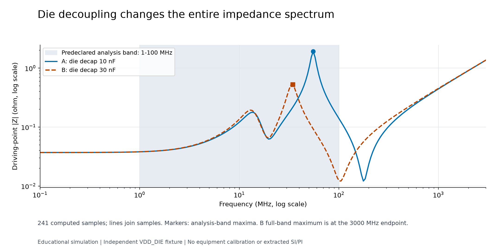
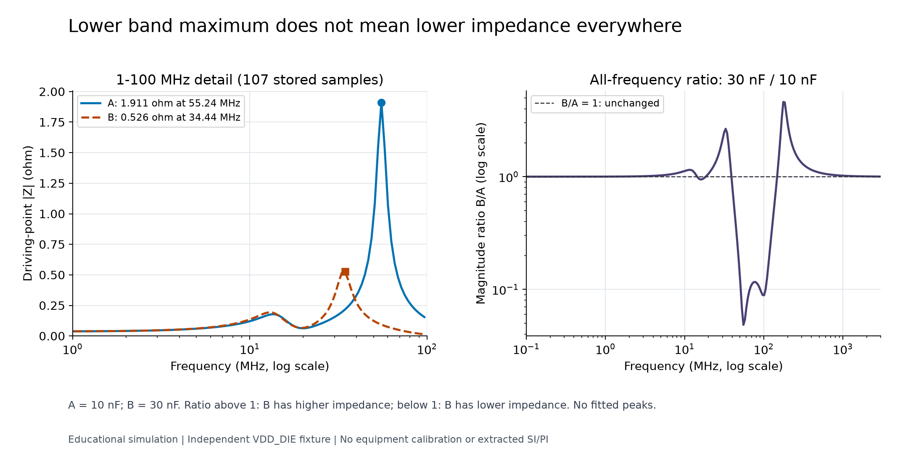

# 실험 08 — Die decap 용량과 전원망 임피던스

**개인 학습용 시뮬레이션 · AI 에이전트 실행. 실제 칩·ATE·VNA 측정 또는 사용자의 장비 운용 경험이 아닙니다.**

같은 VDD_DIE 가상 포트에서 die decap만 **10 → 30 nF**로 바꿨다.
실행 전에 정한 1–100 MHz 구간의 표본 최대 |Z|는 **1.911 → 0.526 Ω**로 낮아졌다.
반면 약 9.91 MHz에서는 |Z|가 증가했다. 용량을 늘린 결과를 한 숫자로만 판단하지 않고 전체 주파수 응답을 비교하는 실습이다.

## 질문과 실행 전 계획

질문: 고정된 기판·VRM·연결 R/L·die ESR/ESL에서 die 커패시턴스만 늘리면 VDD_DIE에서 보이는 임피던스가 어떻게 달라지는가?
가설: 커패시턴스 증가는 일부 주파수에서 임피던스를 낮추지만 피크 위치도 바꾸며 모든 주파수에서 유리하다고 보장하지 않는다.
[plan.json](plan.json)에 질문·가설·조건·분석 대역·측정량을 먼저 고정했다. 결과를 보고 C를 재탐색하거나 목표값에 맞추지 않았다.
이전 ATE 일일 실험은 11월 17일 Eye 모드의 상승 시간 비교였다. 이번 PDN 계산은 새 실행이며 이전 수치를 재사용하지 않았다.

예정 시각: **2026-11-27 20:00 KST**. 자동화 호출: **20:03:48 KST**.
실제 계산 시작: `2026-11-27T20:06:59.780967+09:00`, 보조 검사 포함 완료: `2026-11-27T20:06:59.838061+09:00`.
생성 실험 ID는 `3f116cb541a64f318a849b6829d969e1`이며 서버 job ID가 아니다. GitHub 게시 완료 시각은 커밋/별도 로컬 게시 영수증과 구분한다.

## 입력과 고정한 가상 회로

| 항목 | A | B |
|---|---:|---:|
| 모드 / 측정 포트 | PDN / VDD_DIE | 동일 |
| die decap C | 10 nF | **30 nF** |
| die decap ESR / ESL | 12 mΩ / 0.08 nH | 동일 |
| board decap C / ESR / ESL | 100 nF / 18 mΩ / 0.35 nH | 동일 |
| VRM 직렬 R / L | 25 mΩ / 0.8 nH | 동일 |
| board–die 연결 R / L | 12 mΩ / 0.55 nH | 동일 |
| 주파수 | 0.1–3000 MHz, 로그 간격 241점 | 동일 |

전체 요청은 [A](inputs/A.json), [B](inputs/B.json)에 있다. seed=42를 포함한 공통 입력을 그대로 저장했으나 PDN 분기는 난수를 사용하지 않는다.
rate_gbps, load_ohm, package_z, jitter_ui, rise_ps, strobe_ui, threshold_v도 이번 분기에서는 사용하지 않는 Eye/TDR 입력이다.
공간 격자·시간 적분 간격은 없으며 독립 주파수 해석이다. 이상적 공통 접지를 사용하고 driving-point 임피던스를 구할 때 이상적 VRM 전압원을 0으로 둔다.
이 회로는 Fab Flow 재료 격자·TSV·3D 포트 형상에서 RLGC를 추출한 결과가 아니다. 부품값도 실측이나 특정 부품 데이터시트에 보정한 값이 아니다.

## 계산식과 단위

기존 `fab_lab.ate.simulate`의 PDN 분기는 아래 회로 축약식을 사용한다. 이번 자동화는 해당 수식을 수정하지 않았다.

```text
Zvrm   = Rvrm + jωLvrm
Zbcap  = ESRb + jωESLb + 1/(jωCb)
Zboard = Zvrm || Zbcap
Zlink  = Rlink + jωLlink
Zdcap  = ESRd + jωESLd + 1/(jωCd)
Zdie   = Zdcap || (Zlink + Zboard)
Za || Zb = Za Zb / (Za + Zb)
```

Z는 복소 임피던스 [Ω], R/ESR은 저항 [Ω], L/ESL은 인덕턴스 [H], C는 커패시턴스 [F]다.
첨자 vrm/board/link/die는 전원·기판·연결·die 노드를, bcap/dcap 및 b/d는 각각 기판/die decap을 뜻한다.
f는 주파수 [Hz], ω=2πf [rad/s], j²=−1이며 exp(+jωt) 규약이다. 화면과 CSV의 주파수 단위는 MHz다.
1 MHz=10⁶ Hz, 1 nF=10⁻⁹ F, 1 nH=10⁻⁹ H, 1 mΩ=10⁻³ Ω를 적용한다.
주 결과는 **|Zdie| [Ω]**다. 별도 nodal 검증에서 저장한 실수부·허수부와 구별한다. 임피던스 크기만으로 transient 전압 강하를 산출하지 않았다.

## 결과

| 지표 | A: 10 nF | B: 30 nF |
|---|---:|---:|
| 1–100 MHz 내부 표본 최대 \|Z\| (Ω) | 1.911405 | 0.525834 |
| 위 최대값의 표본 주파수 (MHz) | 55.237850 | 34.437798 |
| 전체 0.1–3000 MHz 표본 최대 \|Z\| (Ω) | 1.911405 | 1.368434 |
| 전체 최대값의 표본 주파수 (MHz) | 55.237850 | 3000.000000 |

분석 대역 내부에는 107개 표본이 있으며 실제 양끝 표본은 1.017073와 96.548938 MHz다.
구간 최대값은 72.49% 감소했지만 서로 다른 주파수에서의 최대값 비교다.
B의 전체 대역 최대값은 **3000 MHz 경계점**이므로 이를 공진 주파수라고 부르면 안 된다. 두 경우 모두 표본 최대값일 뿐 연속 주파수의 정확한 극값은 아니다.

| 같은 주파수에서의 비교 | A \|Z\| (Ω) | B \|Z\| (Ω) | 상대 변화 |
|---|---:|---:|---:|
| 9.909458 MHz (명목 10 MHz에 가장 가까운 표본) | 0.119265 | 0.133607 | +12.02% |
| 100.786456 MHz (명목 100 MHz에 가장 가까운 표본) | 0.137381 | 0.012193 | -91.12% |
| 981.973540 MHz (명목 1000 MHz에 가장 가까운 표본) | 0.435098 | 0.444047 | +2.06% |

명목 10/100/1000 MHz에서 새 계산하거나 보간하지 않고, 사전에 정한 가장 가까운 기존 표본을 읽었다. 실제 표본 주파수를 위에 표시했다.

**Observed:** 분석 구간의 최대값은 작아지고 해당 표본 위치는 낮은 주파수로 이동했다. 그러나 약 9.91 MHz와 981.97 MHz에서는 B의 |Z|가 더 컸다.
**Inferred:** 이 고정 회로에서는 decap 용량 증가가 주파수별 유불리를 함께 바꾼다. 분석하려는 대역과 전체 응답을 함께 확인해야 한다.
**Unknown:** 실제 칩의 전압 강하·타이밍·오류율·부품 선택 적합성은 알 수 없다. 부하 전류 스펙트럼과 허용 전압 리플로 정의한 target impedance는 이번에 설정하지 않아 합격/불합격도 판정하지 않았다.

전체 로그 표본 241개 중 B가 낮은 표본은 37개, 높은 표본은 204개다.
로그 간격이므로 이 개수 비율을 주파수 대역폭 비율이나 통계적 성공률로 해석하지 않는다.

## 실제 수치에서 생성한 그림





선은 실제 저장 표본 연결이며 평활화·추가 표본·피크 피팅을 하지 않았다. 축의 로그/선형 여부를 표기했다.
분석 구간 확대와 전체 대역 그림을 모두 제공하며, 불리한 주파수 구간을 제거하지 않았다. 신뢰구간은 산출하지 않았다.

## 검증

동일 회로값을 사용하는 **2×2 복소 nodal 행렬**을 별도로 구성했다. 각 주파수에서 board/die 노드에 [0,1] A RMS 검증 전류를 넣고 KCL로 전압을 풀었다.
이 1 A는 수치 검사용 정규화 입력이며 실제 ATE에서 주입한 전류가 아니다. 원래 엔진은 임피던스 자체를 계산한다.
die 전압/1 A에서 얻은 |Z|를 엔진 값과 비교하고, 공급 유효전력 Re(Vdie × conj(Itest))와 각 저항의 Σ|Ibranch|²R을 대조했다.
Vdie는 die 노드 복소 RMS 전압 [V], Itest는 검증 RMS 전류 [A], Ibranch는 각 저항 가지의 RMS 전류 [A], 유효전력과 잔차는 W다.

| 검사 | 결과 |
|---|---|
| 정규화 입력은 die decap 하나만 변경 | PASS |
| A/B 전체 출력 각각 정확 재실행 일치 | PASS |
| 양수·유한값, 241점 주파수축·MHz/Ω 단위·UI 최대값 일치 | PASS |
| 전체 482점에서 독립 nodal \|Z\|와 기존 엔진 일치 | PASS |
| Re(Z)>0, KCL 및 저항 전력수지 | PASS |
| 1 Hz 보조 계산에서 DC 한계 25+12=37 mΩ 접근 | PASS |
| 사용하지 않는 seed만 변경 시 파형 불변 | PASS |
| 기존 PDN 포트·용량·잘못된 포트 입력 단위 테스트 1개 | PASS |
| 원본 및 사본 모델 소스 SHA-256 유지 | PASS |
| 주파수 격자 세분화·부품 공차 앙상블·실제 계측 보정 | NOT_RUN |
| 형상 기반 RLGC 추출·전압 강하 transient·능동 VRM 제어 | NOT_MODELED |

독립 해와의 최대 |Z| 차이는 **6.66134e-16 Ω**, 최대 KCL 잔차는 **1.25607e-15 A**, 최대 전력수지 잔차는 **2.22045e-16 W**였다.
이는 동일한 가정의 두 수치 구현이 일치한다는 검사이며 실제 회로의 정확도 입증이 아니다. 1 Hz 보조 계산은 주 비교 0.1–3000 MHz에 섞지 않았다.
검사 원본은 [validation.json](data/validation.json), [unit_test_record.json](data/unit_test_record.json), [nodal_controls.csv.gz](data/nodal_controls.csv.gz)에 있다.

## 재현과 자료

계산 환경은 Python 3.12.2, NumPy 2.5.3, SciPy 1.18.1다.
Python 3.12 및 [requirements.txt](requirements.txt)를 사용해 이 폴더에서 새 출력 경로로 재실행한다.

```shell
python run_experiment.py --out replay
python plot_results.py --data-dir replay
```

그림은 별도 Python 3.12.14 / NumPy 2.1.3 / Matplotlib 3.11.0 / Pillow 환경으로 생성했다. 정확한 그림 환경·픽셀·DPI는 [image_metadata.json](figures/image_metadata.json)에 있다.

- `plan.json`, `inputs/`: 실행 전 고정한 질문·조건·측정 정의.
- `data/A.json`, `B.json`: 원래 함수의 전체 출력, 입력 config·241점·UI reading 포함.
- `frequency_response.csv`: A/B 전체 482행. `comparison.csv`: 동일 주파수 비교 241행.
- `nodal_controls.csv.gz`: 보조 nodal 해의 복소 임피던스·KCL·전력수지·엔진 차이. 무손실 gzip.
- `summary.json`, `execution.json`, `manifest.json`: 요약·실제 시각·생성 ID·명령·버전·해시.
- `source_snapshot/`: 이번 함수 import에 필요한 모듈 5개. RF 모듈은 공통 입력 검증의 의존성이며 RF 실험을 함께 실행하지 않았다.

기존 작업트리에 다른 수정이 있어 원격 Git SHA만으로 모든 로컬 소스를 복원할 수 있다고 주장하지 않는다. 포함한 사본과 SHA-256이 재현 기준이다.
모델 수식·앱 코드는 이번에 수정하지 않았고 수치 산출물 생략도 없다. 내부 전원망은 고정 ESR/ESL과 이상적 접지이며 실제 분포선로·주파수 의존 손실·온도/바이어스 의존 C를 보정하지 않았다.

다음 PI 질문: 실제 부품에서 용량과 함께 ESR/ESL도 달라질 때 같은 경향이 유지되는가? 이번에는 수행하지 않았다.
게시 완료 후 다음 일일 주제는 **GAA·자유공정**이다.
