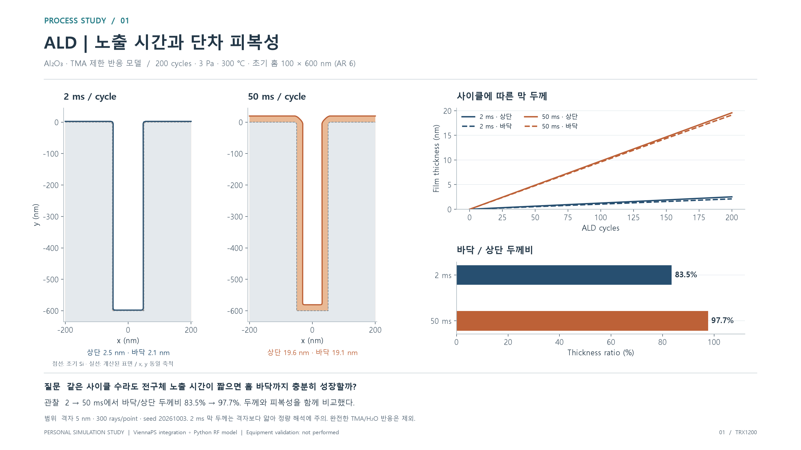
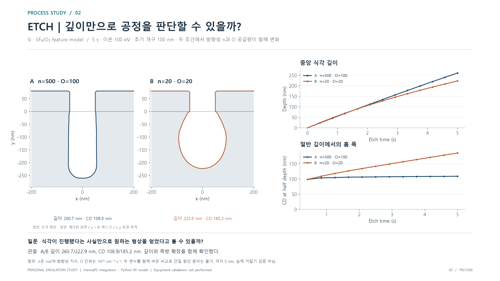
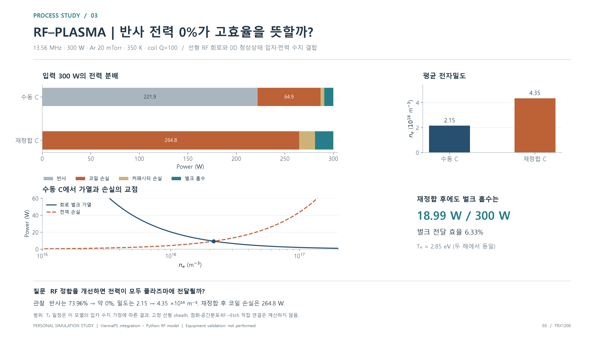

# ALD · Etch · RF–플라즈마 학습 포트폴리오

포트폴리오에 바로 넣을 수 있는 3200 × 1800 PNG 3장, 확대용 SVG 3장, CSV 4개와 원본 계산 JSON 5개입니다. 모든 그림은 저장된 계산 결과에서 다시 그렸습니다. 이번 내보내기에서 새로 계산한 공정 결과나 실제 장비 측정값은 포함하지 않습니다.

[프로젝트 GitHub](https://github.com/TRX1200/pse-process-recovery-lab) · [공개 화면](https://trx1200.github.io/pse-process-recovery-lab/)

## 1. ALD: 노출 시간을 바꾸면 무엇을 봐야 할까?

- 질문: 사이클 수가 같으면 깊은 홈의 막 두께도 같을까?
- 비교: 200 cycles, TMA 분압 3 Pa, 300 °C, 폭 100 nm / 깊이 600 nm를 유지하고 노출 시간만 2 ms와 50 ms로 비교했습니다.
- 관찰: 상단 두께 2.52 → 19.57 nm, 바닥 두께 2.10 → 19.12 nm, 바닥/상단 두께비 83.47 → 97.68%입니다.
- 해석: 이 조건에서는 사이클 수뿐 아니라 전구체 노출과 구조 내부 공급을 함께 봐야 합니다. 상단 성장량만으로 깊은 홈 전체의 피복성을 판단하지 않습니다.
- 한계: 2 ms 조건의 막 두께는 5 nm 격자보다 얇습니다. 레벨셋에서 격자 이하 위치를 표현할 수 있어도 그 수치의 정량 신뢰도가 입증되는 것은 아닙니다. 격자·입자 수·시드 변화에 대한 추가 확인이 필요합니다. 두 조건만으로 포화 노출 시간을 확정하지 않습니다.

**그림 캡션:** “ALD 전구체 노출 시간을 달리하며 상단·바닥 두께와 단차 피복성을 비교했습니다. 같은 사이클 수에서도 노출 조건에 따라 결과가 달라지는 것을 확인하고, 격자 해상도가 해석에 미치는 한계도 함께 검토했습니다.”

**이해할 관계:** 바닥/상단 두께비 = 100 × 바닥 두께 / 상단 두께. 모델의 성장량은 위치별 피복률에 비례하며, 반대 반응과 퍼지는 완료됐다고 가정합니다. 완전한 TMA/H₂O 반응·불순물·실제 장비 온도 의존성을 검증한 결과는 아닙니다.

## 2. Etch: 깊이와 CD를 함께 보는 이유

| 조건 | 방향성 지수 n | O 플럭스* | 5 s 깊이 | 절반 깊이 CD |
|---|---:|---:|---:|---:|
| A | 500 | 100 | 260.67 nm | 108.88 nm |
| B | 20 | 20 | 222.92 nm | 185.25 nm |

\* O 플럭스 단위: 10¹⁵ cm⁻² s⁻¹. 방향성 지수는 cosⁿθ 입사 분포의 입력이며 챔버 압력에서 계산된 값이 아닙니다. 공통 조건은 100 eV 이온, 5 s, 초기 개구 100 nm, 격자 5 nm, 300 rays/point, seed 20261003입니다.

- 질문: 일정 깊이까지 식각했다면 형상도 잘 나온 것일까?
- 관찰: B는 A보다 얕지만 홈 폭은 훨씬 넓습니다. 최종 단면과 시간별 깊이·CD를 함께 보면 식각량과 측방 확장의 차이가 드러납니다.
- 해석: 원하는 공정을 판단하려면 깊이 외에 CD, 측벽 형상, 마스크 손실 등 여러 지표가 필요합니다. 목표 사양이 없으므로 A/B를 실제 장비의 합격·불합격으로 표시하지 않았습니다.
- 한계: n과 O 플럭스가 동시에 바뀌었습니다. 어느 하나가 차이의 단독 원인이라고 말할 수 없습니다. 다음 실험은 n={20,500} × O={20,100}의 2×2 비교로 주효과와 상호작용을 분리하는 것입니다. 이 4조건 실험을 완료했다고 주장하지 않습니다.

**그림 캡션:** “식각 조건에 따른 단면 변화와 깊이·CD 추이를 비교했습니다. 식각 깊이만으로 결과를 판단하기 어렵다는 점을 확인했으며, 방향성과 보호종 공급량의 영향을 구분하기 위한 추가 비교 조건을 정리했습니다.”

단면은 실제 계산 좌표를 동일 축척으로 그렸습니다. y>0 영역은 마스크입니다. 표면의 미세한 굴곡에는 격자와 Monte Carlo 표본 오차가 포함될 수 있어 실제 거칠기나 ripple 발생의 증거로 사용하지 않습니다.

## 3. RF–플라즈마: 정합과 흡수 효율의 차이

| 지표 | 수동 C | 재정합 C |
|---|---:|---:|
| 반사율 | 73.96% | 약 0% |
| 벌크 흡수 전력 | 9.40 W | 18.99 W |
| 코일 손실 | 64.91 W | 264.81 W |
| 커패시터 손실 | 3.80 W | 16.20 W |
| 전자밀도 | 2.15 × 10¹⁶ m⁻³ | 4.35 × 10¹⁶ m⁻³ |
| 전자온도 | 2.85 eV | 2.85 eV |

- 질문: 발생기에서 반사가 사라지면 전력이 모두 플라즈마에 전달될까?
- 관찰: 재정합 후 반사는 거의 없어졌지만, 300 W 중 벌크 흡수는 18.99 W, 약 6.33%입니다. 이 모델에서는 대부분의 전력이 코일에서 소모됩니다.
- 해석: 정합은 발생기가 보는 임피던스를 조정하는 문제이며, 벌크 전달 효율은 소자 손실까지 포함해 따로 확인해야 합니다. 밀도 증가만으로 전체 시스템이 효율적이라고 결론 내리지 않습니다.
- 다음 확인: 코일 Q와 회로 구조를 바꾸면서 벌크 흡수뿐 아니라 코일 전류와 커패시터 전압도 확인합니다. 재정합 결과는 약 12.47 A RMS, 1179.16 V RMS이며, 실제 부품 정격은 별도 데이터시트가 필요합니다.

**그림 캡션:** “RF 전공과 연결해 매칭 회로와 Ar 플라즈마의 정상상태 수지를 함께 계산했습니다. 재정합 전후의 반사율·전자밀도·전력 분배를 비교하면서, 낮은 반사율이 높은 플라즈마 전달 효율을 뜻하지는 않는다는 점을 확인했습니다.”

**검산한 관계:** 입력 전력 = 반사 전력 + 코일 손실 + 커패시터 손실 + 벌크 흡수 전력. 벌크 효율 = 100 × 벌크 흡수 전력 / 입력 전력. 정상상태에서 벌크 가열 = 전역 플라즈마 손실입니다. RMS, exp(+jωt) 규약을 따르며 추가 1/2 계수를 넣지 않습니다.

전자온도가 동일한 것은 이 모델에서 고정 압력·기하 조건의 입자 수지가 온도를 정하기 때문입니다. 실제 플라즈마에서 항상 일정하다는 뜻은 아닙니다. 고정 선형 sheath와 균일한 0D Ar 모델이며 점화·공간분포·비선형 sheath·Ar→SF₆/O₂ 식각 연결은 계산하지 않습니다.

## 자료 사용과 재현

- PNG: PowerPoint·Word·포트폴리오에 바로 삽입합니다. 16:9 비율을 유지하세요.
- SVG: 확대하거나 인쇄할 때 사용합니다. 글꼴은 경로로 저장돼 다른 PC에서도 모양이 유지됩니다.
- `data/native_metrics.csv`: 4개 ALD/Etch 조건의 프레임별 지표. `at` 단위는 `axis_unit`을 확인합니다. 초기 ALD의 0/0 두께비는 빈 값입니다.
- `data/native_contours.csv`: 그림의 실제 단면 좌표. 단위 nm, x 수평, y 위쪽 양수. 별도 평활화는 없습니다.
- `data/rf_power_balance.csv`: 두 RF–Ar 해의 수치와 독립적으로 합산한 전력 잔차.
- `data/rf_density_balance_curve.csv`: 수동 C에서의 밀도별 가열·손실 곡선. 시간 이력이 아닙니다.
- JSON 5개: 원본 입력, 가정, 엔진 버전, 수치 설정, run/config hash와 전체 결과.
- `manifest.json`: 원본 소스 커밋, 복사본 SHA-256, 렌더러 버전, 수치 교차 확인 내역.

저장된 4개 native 결과의 모든 프레임에서 좌표 유한성·중앙 측정값·ALD 두께비를 교차 확인했습니다. RF의 전력 항 합과 전역 전력 수지 잔차를 확인했습니다. 이는 데이터 내보내기와 수치 일관성 검사이며 물리적 정확도, 격자 수렴, 장비 일치의 검증이 아닙니다.

이미지 재생성: 저장소 루트에서 `python portfolio/2026-10-process-study/export_portfolio.py`. Python, NumPy, Matplotlib 및 Windows 맑은 고딕이 필요합니다. 엔진 코드는 변경하지 않았습니다.

이 자료는 개인 학습 프로젝트의 설명 자료입니다. 실제 공정 수행 경력이나 ViennaPS 자체 개발 실적으로 표현하지 마세요. 구현 범위는 공개 엔진 통합, 입력·결과·비교 UI, Python RF 모델, 분석 및 재현 가능한 결과 정리입니다. 캡션은 자신의 이해와 실제 수행 범위에 맞춰 사용하세요.

## 배경 자료

- [ViennaPS v4.6.2](https://github.com/ViennaTools/ViennaPS/tree/v4.6.2): 사용한 공개 feature-scale 엔진. 네이티브 환경은 원본 JSON에 기록돼 있습니다.
- [Aguinsky et al., Modeling Incomplete Conformality during Atomic Layer Deposition in High Aspect Ratio Structures](https://arxiv.org/abs/2210.00749): ALD 피복률·수송 모델의 배경. 이 포트폴리오는 논문의 장비 보정이나 전체 실험을 재현한 것이 아닙니다.
- [Schmidt et al., Consistent simulation of capacitive radio-frequency discharges and external matching networks](https://arxiv.org/abs/1804.05638): 회로–플라즈마 결합을 공부하기 위한 배경. 여기의 단순한 정상상태 모델은 논문의 비선형 동역학을 재현하지 않습니다.
